# 편의점 입지 추천 서비스 — 강남·송파 상권 분석 (4팀)

> **어디에 열어야 돈이 남을까.** 공공데이터 20종으로 강남구·송파구(와 도곡동 인근 서초구) 상권을 분석해, 두 창업자에게 **입지 점수 → ROI** 두 단계로 편의점 상권 3곳씩을 추천한다.

이 문서는 **수집 → 전처리 → 분석 → 결과 도출** 순서로 읽는다. 발표 자료(`편의점_입지추천_최종발표`, 46장)와 이 저장소의 분석 코드를 한 번에 설명하며, 모든 숫자는 `eda_output/`의 결과 파일에서 자동으로 가져왔다(`scripts/build_readme.py`). 발표 자료와 어디가 같고 어디가 다른지는 [9. 발표 자료와 이 코드의 일치도](#9-발표-자료와-이-코드의-일치도)에 적었다.

## 목차

| 단계 | 장 |
| :--- | :--- |
| 문제 | 1. [프로젝트 개요](#1-프로젝트-개요) |
| 수집 | 2. [데이터 수집](#2-데이터-수집) |
| 전처리 | 3. [데이터 전처리](#3-데이터-전처리) |
| 분석 | 4. [분석 방법과 정의](#4-분석-방법과-정의) · 5. [상권 분석](#5-상권-분석-결과) · 6. [입지 점수와 추천](#6-입지-점수와-추천) · 7. [ROI와 추천](#7-roi와-추천) |
| 결과 도출 | 8. [결과 도출과 시사점](#8-결과-도출과-시사점) |
| 검증·정리 | 9. [발표 자료와 이 코드의 일치도](#9-발표-자료와-이-코드의-일치도) · 10. [한계](#10-한계와-확인할-것) · 11. [코드와 실행 방법](#11-코드와-실행-방법) · 12. [폴더 구조](#12-폴더-구조) · 13. [그림 모음](#13-그림-모음) · 14. [발표 자료 장표별 시각화와 근거](#14-발표-자료-장표별-시각화와-근거) · 15. [출처와 이용 조건](#15-출처와-이용-조건) |

## 1. 프로젝트 개요

### 1.1 풀려는 문제

편의점 창업자는 "어디에 열까"를 감으로 정하기 쉽다. 이 프로젝트는 공공데이터로 상권마다 입지 점수와 예상 수익(ROI)을 계산해 근거 있는 후보를 보여주는 서비스를 만든다. 서비스는 네 단계다.

1. **입지 분석(기본)**: 매출·인구·교통·경쟁 데이터로 상권마다 입지 점수를 계산한다.
2. **내 조건 반영(특별함)**: 자금·알바 시간·성향에 맞춰 가중치를 달리 적용한다.
3. **순이익·손익분기**: 알바비·월세·가맹 배분율을 반영한 월 순이익을 계산한다.
4. **ROI**: 가진 돈으로 가장 많이 남기는 곳을 최종 순위로 한다.

|  | A | B |
| :--- | :--- | :--- |
| 신분 | 직장인, 퇴근 후 밤에 직접 운영 | 은퇴 후 주 수입원으로 창업 |
| 자금 | 최대 5,000만원 | 가용 2.5억원(2호점 고려) |
| 지역 | 강남·송파 어디든 | 도곡동 중심점 반경 1.5km(자치구 무관, 서초 포함) |
| 운영 | 알바 3타임, 하루 18시간 | 알바 2타임, 하루 12시간 |
| 중시 | 심야 매출, 인건비 | 안정성, 아파트 배후 |
| 후보 상권 | 강남·송파 실측 90곳 | 도곡동 반경 실측 10곳(강남 6, 서초 4) |

### 1.2 분석 과정 한눈에

```
수집        전처리              분석                                          결과 도출
원천 20종 ─► 상권 단위 지표 표 ─► 상권 성격 ─► 입지 점수 ─► 월 순이익·ROI ─► 추천 3곳 · 순위 변동 · 시사점
(2장)       실측 후보 선별(3장)  (4·5장)     (6장)        (7장)             (8장)
```

| 단계 | 한 일 | 핵심 결과 |
| :--- | :--- | :--- |
| 1 수집 | 서울시·공공데이터포털·R-ONE·브랜드 안내에서 20종을 모았다(2장). | 서울 전체 상권 1,650곳의 매출·점포·인구·교통·경계, 강남·송파·서초의 아파트·상가, 임대료·가맹 조건 |
| 2 전처리 | 편의점만 골라 점포당 월매출·심야 비중·세대수·접근성 같은 상권 단위 지표로 바꾸고, 매출이 공시되지 않는 상권은 순위에서 뺐다(3장). | 후보 상권 184곳 중 A 90곳, B 10곳을 실측 후보로 확정 |
| 3 분석① 상권 | 시장 국면, 매출을 가르는 요인, 상권 유형을 살폈다(5장). | 점포당 매출 차이의 95%는 하루 결제 건수에서 나온다. 편의점 수는 정점 대비 -12.2% |
| 4 분석② 입지 점수 | A와 B에 다른 가중치를 줘 상권마다 점수를 매겼다(6장). | A 입지 상위 3곳: 석촌고분역 4번 · 석촌고분역 1번 · 방이동먹자골목 / B 입지 상위 3곳: 뱅뱅사거리 · 양재역 · 매봉역 |
| 5 분석③ ROI | 알바비·월세·가맹 조건을 넣어 월 순이익과 투자 대비 수익을 계산했다(7장). | A ROI 추천 3곳: 장지역(가든파이브) · 한티역 · 삼성역 / B ROI 추천 3곳: 교육개발원입구사거리 · 뱅뱅사거리 · 포이사거리(삼호물산) |
| 6 결과 도출 | 입지만 볼 때와 ROI를 더했을 때 순위가 어떻게 바뀌는지 비교하고 시사점을 냈다(8장). | 입지 상위와 ROI 상위는 다른 상권이다 |


## 2. 데이터 수집

서울 열린데이터광장, 공공데이터포털, 한국부동산원 R-ONE, 브랜드 공식 안내, 최저임금위원회에서 모은 20종을 쓴다(수집일 2026-09-17–19, 서초 추가 수집 2026-10-07). 원천 파일은 `data_bundle/`에 zip 조각으로 들어 있고(파일당 100MB 제한 때문에 45MB씩 5조각), `python scripts/setup_data.py`로 합쳐 풀면 `data/`가 된다(풀어낸 `data/` 자체는 `.gitignore`). 파일 목록과 SHA256 지문은 `docs/파일목록.csv`, 수집 과정과 알려진 한계는 `docs/데이터_README.md`(데이터 안내)에 있다.

분석에 필요한 것은 <b>매출·점포(수요와 경쟁), 사람(상주·직장·유동), 이동(지하철·버스), 공간(상권 경계), 주거(아파트), 비용(임대료·가맹 조건·최저임금)</b>이다. 이를 아래 20종으로 채웠다.

| 데이터 | 출처 | 행 수와 단위·기간 | 이 프로젝트에서의 용도 |
| :--- | :--- | :--- | :--- |
| 01 추정매출_상권 | 서울 열린데이터광장 | 상권×분기 추정매출(서울 전체), 481,462행 | 점포당 매출, 시간대·요일·성별·연령 매출, 결제 건수·객단가 |
| 02 점포_상권 | 서울 열린데이터광장 | 상권×분기, 2021–2026(연도별 파일), 1,680,756행 | 점포 수(SIMILR_INDUTY_STOR_CO), 개업·폐업률, 프랜차이즈 점포 |
| 03 상권변화지표 | 서울 열린데이터광장 | 상권×분기, 36,300행 | 상권변화 4분류, 운영·폐업 평균 영업개월(상권 안정성) |
| 04 길단위인구 | 서울 열린데이터광장 | 상권×분기, 36,281행 | 유동인구, 심야 유동 비중, 경쟁밀도의 분모 |
| 05 상주인구 · 06 직장인구 | 서울 열린데이터광장 | 기준 2023-12 · 2024-12, 35,908 · 36,027행 | 상주·직장인구, 연령 구성, 가구 수 |
| 07 집객시설 | 서울 열린데이터광장 | 기준 2020-12, 34,716행 | 병원·은행·학교·약국 등(상관 분석에만 사용) |
| 08 생활인구(행정동) | 서울 열린데이터광장 | 행정동×시간대, 630,988행 | 행정동 단위 심야 생활인구 비중(상관 분석에만 사용) |
| 09 지하철역 · 10 버스정류소 | 서울 열린데이터광장 | 좌표(역은 수도권 전역), 784 · 11,236행 | 대중교통 접근성(지하철 400m×2 + 버스 300m) |
| 11 상권경계(shapefile) | 서울 열린데이터광장 | 서울 전체 상권 폴리곤(EPSG:5181), 1,650행 | 면적, 중심점, 경계 400m 반경 계산 |
| 12·13·18 공동주택 | 공공데이터포털(국토교통부) + 브이월드 지오코딩 | 단지별 세대수·좌표, 410 + 서초 203행 | 아파트 세대수(경계 400m) |
| 14 소상공인 상가정보 | 공공데이터포털(소진공) | 업소별 위치, 101,129 + 서초 40,115행 | 편의점 위치(중복 제거), 반경 300m 편의점 수(팀 정의 경쟁밀도는 02·04번 사용) |
| 15 임대료 · 16 층별 임대료 · 17 공실률 | 한국부동산원 R-ONE | 소규모상가, 권역×분기, 2,208 · 13,248 · 2,208행 | 1층 임대료(천원/㎡·월)와 공실률. 16번은 15번과 같은 값 확인용 |
| 19 가맹조건(수작업) | CU·GS25·이마트24·세븐일레븐 공식 안내 | 브랜드×가맹 타입, 32행 | 필요현금, 경영주 배분율, 임차 부담 주체, 보증금 |
| 20 운영비 기준값 | 최저임금위원회 | 연도별 최저임금, 4행 | 2026 최저시급 10,320원 |

- 1–11번은 서울 전체(상권 1,650곳)를 받았고, 이 프로젝트에서 강남구·송파구와 도곡동 반경의 서초구 상권만 골라 쓴다. 12–14번은 강남·송파(와 추가로 받은 서초)만 들어 있다.
- **매출·점포(01·02번)가 분석의 뼈대**다. 나머지는 이 뼈대에 사람(04–08번), 이동(09·10번), 공간(11번), 주거(12·13·18번), 비용(15–17·19·20번)을 붙이는 데 쓴다.
- 07번 집객시설과 08번 생활인구는 상관 분석에만 쓰고 입지 점수에는 넣지 않았다. 16번 층별 임대료는 15번과 같은 값인지 확인하는 용도다.
- 분석 단위는 서울시 <b>상권(TRDAR_CD)</b>이다. 후보는 강남구 103 + 송파구 70 = 173곳과, B의 반경 조건에 걸린 서초구 11곳이다.
- 기준 시점: 매출·점포는 최근 4분기(2025Q3부터 2026Q2까지)의 평균, 임대료는 2026Q2, 상주인구는 2023-12, 직장인구는 2024-12, 집객시설은 2020-12 고정값이다. 인구·집객시설은 분기별 차이를 실제 변화로 읽을 수 없다.

## 3. 데이터 전처리

수집한 원천은 서울 전체 상권과 모든 업종이 섞여 있고 기준 시점·단위·좌표계가 제각각이다. 이를 **편의점 상권 하나가 한 행**인 지표 표로 바꾸는 과정이다. 원천 CSV는 고치지 않고(`data/`는 읽기 전용) 모든 처리 결과를 `eda_output/`에 새로 쓴다. 코드값(상권코드·행정동코드·업종코드)은 문자열로 읽어 앞자리 0을 지킨다. 값이 없으면 0이나 중앙값으로 채우지 않고 결측으로 둔다. "매출이 없다"와 "매출을 계산할 수 없다"는 다른 뜻이기 때문이다. 처리 순서는 아래와 같다(규칙 전문은 `docs/전처리_기준서.md`).

| 단계 | 처리 | 한 일 | 이유 |
| ---: | :--- | :--- | :--- |
| 1 | 편의점만 고르기 | 01·02번은 `SVC_INDUTY_CD == 'CS300002'`, 14번 상가정보는 `indsSclsNm == '편의점'`. | 서울 전 업종 데이터에서 편의점 행만 남긴다. |
| 2 | 상가정보 중복 제거 | 상호명 + 도로명주소가 같은 행 43건을 지워 1,386곳을 1,364곳으로 줄인다. | 같은 점포가 점주 명의와 브랜드 명의로 두 번 등록된 경우가 있다. |
| 3 | 점포 수 분모 통일 | 점포당 지표의 분모는 항상 `SIMILR_INDUTY_STOR_CO`(= 일반 `STOR_CO` + 프랜차이즈 `FRC_STOR_CO`). | 서울 전체 1,680,756행에서 이 식이 100% 성립한다. 일반 점포 수만 쓰면 점포당 매출이 3–4배 부풀려진다. |
| 4 | 금액을 월 단위로 | `THSMON_SELNG_AMT`는 이름과 달리 분기 합계다. 분기별로 (매출 ÷ 점포 수)를 구해 최근 4분기를 평균하고 3으로 나눈다. | 점포당 월매출의 정의다. |
| 5 | 구성비 계산 | 성별·연령대 구성비는 총매출이 아니라 해당 축의 합계로 나눈다. 분모가 0이면 결측으로 둔다. | 성별·연령대 매출의 합이 총매출보다 작을 수 있다. |
| 6 | 시간대 정의 | 심야 = 21–06시(`TMZON_21_24` + `TMZON_00_06`), 주간 = 06–17시(`TMZON_06_11` + `TMZON_11_14` + `TMZON_14_17`). | A는 심야, B는 주간 매출 비중을 본다. |
| 7 | 기준 분기 | 데이터에서 최근 4개 분기를 매번 계산한다(이번에는 2025Q3, 2025Q4, 2026Q1, 2026Q2). | 특정 분기의 일시적 변동을 줄인다. |
| 8 | 지역 거르기 | 상권 이름이 아니라 상권경계의 `SIGNGU_CD_`로 자치구를 정한다. B는 도곡동 상권 중심점의 평균을 기준점으로 EPSG:5181 평면거리 1.5km 안의 상권을 자치구와 무관하게 자른다(서초 11곳 포함). | '강남역' 상권은 실제로 서초구 소속이다. |
| 9 | 트랙 분리 | 실측 = 최근 4분기 모두 편의점 매출이 공시되고 월 100만원 이상인 상권. 매출불명 = 점포는 있으나 매출이 비공개인 상권. 후보제외 = 점포 존재 증거가 없는 상권. 점수와 ROI는 실측만 매긴다(A 90곳, B 10곳). | 점포가 3곳 이하인 상권은 서울시가 표본이 작아 매출을 공표하지 않는다. 매출 없음은 수요 없음이 아니므로 0으로 채우지 않고 순위에서 뺀다. |
| 10 | 공간 데이터 보정 | 상권경계 shapefile(EPSG:5181)에서 모양이 깨진 도형 6개를 `buffer(0)`으로 고친다. 거리 계산은 EPSG:5181, 지도 표시는 WGS84(EPSG:4326)로 한다. | 깨진 도형은 면적·포함 판정이 틀어진다. |
| 11 | 아파트 세대수 | 공동주택 단지를 `kaptCode`로 중복 제거하고(강남·송파 410 + 서초 203단지), 세대수(`kaptdaCnt`)가 0인 단지는 호수(`hoCnt`)로 대체한다. 상권경계(폴리곤)에서 400m 안에 들어오는 단지의 세대수를 합한다. | 청년주택 등은 세대수가 0으로 들어 있다. 서초를 합치지 않으면 서초 상권의 세대수가 0이 된다. |
| 12 | 접근성과 경쟁밀도 | 접근성 = 상권 중심점 기준 지하철역 400m 안 개수 × 2 + 버스정류소 300m 안 개수. 경쟁밀도 = 최근 4분기 평균 편의점 수 ÷ 4분기 평균 유동인구(10만명 단위). | 지하철역 원천은 수도권 전역이라 반경 안의 역만 센다. 경쟁밀도는 사람 수 대비 점포 수다. |
| 13 | 최신 스냅샷만 | 상주·직장인구, 집객시설, 공동주택은 가장 최근 시점 한 장만 쓴다. 상권 안정성은 03번 상권변화지표의 평균 영업개월(최신 분기)이다. | 기준 시점이 달라 분기별 값을 이어 붙이면 가짜 변화가 생긴다. |
| 14 | 임대료 매핑 | R-ONE 1층 임대료는 상권이 아니라 넓은 권역 단위라 구 단위로 모은다(강남 64.6, 송파 34.0, 서초 45.4 천원/㎡·월, 2026Q2). 월세 = 임대료 × 66㎡. | 상권별 임대료가 없어 구 평균으로 갈음했다. |
| 15 | 가맹 조건 정리 | 브랜드 공식 안내 32행을 손으로 옮겼다. 운영시간에 '24'가 있고 '미영업'이 없는 행만 남기고 같은 (브랜드, 타입)은 첫 행만 쓴다. CU GREEN 1·2는 월 임차부담금 금액이 없어 뺀다(14개 타입). | 심야 운영 편의점만 비교한다. |
| 16 | 정규화와 이상값 | 지표는 후보 안 백분위로 바꾼다. 점포당 매출이 IQR 상한을 넘는 5곳은 지우지 않고 표시하며 ROI 추천에서만 뺀다. | 점포당 매출·인구는 왜도가 2–3으로 크게 쏠려 최댓값 한 곳이 나머지를 눌러 버린다(min-max의 문제). 백분위는 극단값의 영향을 줄인다. |

**전처리 결과:** 후보 상권 184곳(강남 103 + 송파 70 + 서초 11) 가운데 점수와 ROI를 매기는 실측 후보는 A 90곳, B 10곳이다. 이 표가 `eda_output/analysis/feature_extended.csv`(확장 피처)와 `eda_output/team/feature_team.csv`(팀 정의 피처)다.

- A와 B는 후보 모수가 달라(A 90곳, B 10곳) 각자 후보 안 백분위로 점수를 매기므로 **두 점수는 서로 비교할 수 없다**.
- 담배소매인 이격거리는 원천이 없어 반영하지 못했다(10절). 2호점 예산(1호점 × 2) 검증도 하지 않았다.
- 서초 추가분은 `data/data_go_kr/12_13_18_공동주택/공동주택_서초_*.csv`와 `14_소상공인_상가정보/상가정보_서초.csv`이고 설명은 `docs/서초추가_README.md`에 있다.

## 4. 분석 방법과 정의

전처리한 지표로 **입지 점수 → 월 순이익 → ROI**를 계산한다. 계산에 쓰는 용어와 식은 아래와 같다.

### 핵심 정의
| 용어 | 정의 |
| :--- | :--- |
| 점포당 월매출 | 분기별 (매출 ÷ 같은 분기 `SIMILR_INDUTY_STOR_CO`)를 최근 4분기 평균하고 ÷3. 분모는 일반+프랜차이즈 전체 점포 수. 일반 점포 수로 나누면 약 3배 부풀려진다. |
| 심야 / 주간 | 심야 21–06시, 주간 06–17시 |
| 심야 인건비 대비 배율 | 점포당 월 심야매출 ÷ (알바 1명 심야 9시간 × 30일 × 최저시급 = 279만원). 분모가 같아 순위는 점포당 심야매출과 같다. |
| 경쟁밀도 | 상권 편의점 수(4분기 평균) ÷ 분기 유동인구(10만명). 높을수록 감점 |
| 상권 안정성 | 03번 상권변화지표의 평균 영업개월(최신 분기) |
| 아파트 세대수 | 상권 경계(폴리곤)에서 400m 이내 공동주택 단지 세대수 합 |
| 대중교통 접근성 | 상권 중심점 기준 지하철역(400m)×2 + 버스정류소(300m) |
| 입지 점수 | Σ(가중치 × 백분위). 경쟁밀도는 가중치가 음수라 백분위를 그대로 뺀다(감점). 백분위는 후보 안(A 90곳, B 10곳)에서 계산해 A·B 점수는 서로 비교할 수 없다. |
| 월 순이익 | 점포당 월매출 × 25% × 경영주 배분율 − 알바 인건비 − 월세(점주 임차형만). 카드수수료는 팀 합의로 제외. |
| 알바 인건비 | 2026 최저시급 10,320원 × 주휴 1.2 × 30일 × 하루 근무시간 → A 18시간 669만원, B 12시간 446만원 |
| 월세 | R-ONE 1층 임대료를 구 단위로 모아(강남 64.6, 송파 34.0, 서초 45.4 천원/㎡) × 66㎡. 본부 임차형 가맹 타입은 월세 0 |
| ROI(연) | 월 순이익 × 12 ÷ 필요현금(개점투자 + 담보). 회수기간 = 필요현금 ÷ 월 순이익 |
| 가맹 타입 선택 | 예산(A 5,000만, B 2.5억) 안 24시간 타입 중 ROI가 가장 큰 타입. 24시간 타입 = 운영시간에 '24'가 있고 '미영업'이 없는 행이며 같은 (브랜드, 타입)은 파일의 첫 행만 쓴다(이마트24는 '24H 미운영' 행이 먼저라 배분율이 낮은 쪽). 16개 중 CU GREEN 1·2(월 임차부담금 금액 불명)를 빼 14개를 비교한다. |
| 손익분기 월매출 | (알바비 + 월세) ÷ (25% × 배분율). A는 GS25 GS2(배분율 65%, 본부 임차) 기준 4,115만원, B는 2,744만원 |
| 안전마진 | 점포당 월매출 ÷ 손익분기 월매출 − 1 |
| ROI 추천 규칙 | 흑자 상권만, 점포당 매출 이상값(IQR 상한 초과) 5곳 제외, ROI 순 |

## 5. 상권 분석 결과

### 5.1 시장은 구조조정 중이다
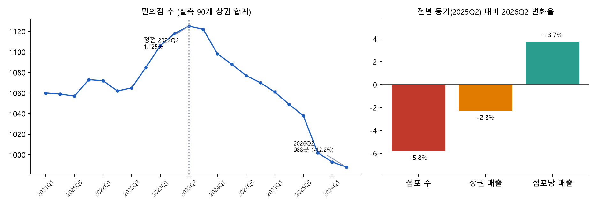

실측 90개 상권의 편의점 수 합계는 2023년 3분기 1,125곳에서 2026년 2분기 988곳으로 줄었다(-12.2%). 최근 1년(2025Q2→2026Q2)에도 점포 -5.8%, 상권 매출 -2.3%로, 점포가 매출보다 빨리 줄었고 그 결과 점포당 매출은 +3.7% 늘었다. 폐업률이 개업률의 2배 이상이라는 점도 같은 방향이다(5.7절).

### 5.2 매출은 결제 건수가 가른다
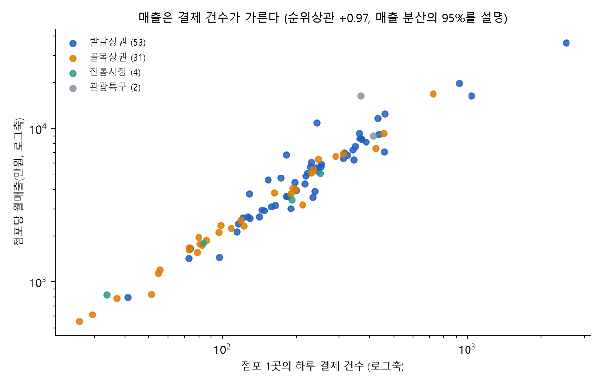

| 상권구분 | 상권 수 | 하루 결제 건수(점포당) | 점포당 월매출(만원) | 객단가(원) |
| :--- | ---: | ---: | ---: | ---: |
| 골목상권 | 31 | 109 | 2,312 | 7,062 |
| 관광특구 | 2 | 390 | 12,670 | 11,057 |
| 발달상권 | 53 | 229 | 5,140 | 7,069 |
| 전통시장 | 4 | 138 | 2,615 | 6,942 |

객단가는 관광특구를 빼면 약 7,000원대로 비슷하다. 그래서 골목상권과 발달상권의 매출 차이(약 2.2배)는 단가가 아니라 하루 결제 건수(109건 대 229건)에서 나온다. 로그 점포당 매출 분산의 95%를 결제 건수가 설명한다.

### 5.3 낮에 강한 직장·번화형과 밤에 강한 주거·골목형
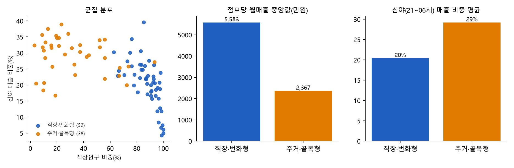

| 군집 | 상권 수 | 점포당 월매출 중앙값(만원) | 직장인구 비중 중앙값 | 편의점 수 평균 | 상주+직장인구 중앙값 | 심야매출비중 | 주간매출비중 | 안정성(영업개월) | 접근성 |
| :--- | ---: | ---: | ---: | ---: | ---: | ---: | ---: | ---: | ---: |
| 주거·골목형 | 38 | 2,367 | 25% | 5.4 | 7,066 | 29% | 42% | 112 | 8 |
| 직장·번화형 | 52 | 5,583 | 90% | 15.4 | 17,290 | 20% | 53% | 116 | 9 |

직장인구 비중 90% 안팎의 직장·번화형은 점포당 매출이 크고 심야 비중이 낮으며, 직장인구 비중 25% 안팎의 주거·골목형은 반대다. 같은 편의점이라도 업무형은 '낮 매출 사업', 주거형은 '밤·생활 사업'이다. 이 구분이 A와 B의 가중치가 달라지는 출발점이다.

### 5.4 밤에 사람이 많다고 밤 매출이 되는 것은 아니다 (A의 핵심 조건)
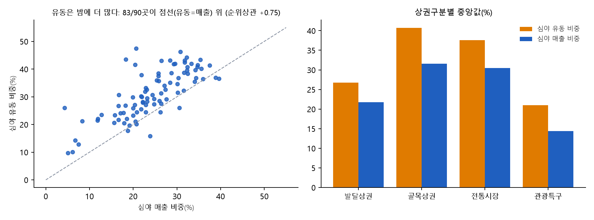

심야 유동 비중이 높은 상권은 심야 매출 비중도 높지만(순위상관 +0.75), 83/90곳에서 매출 비중이 유동 비중보다 낮다. 밤 유동 약 30%가 밤 매출 약 24%로 이어진다. 그래서 심야 유동은 점수에서 심야 매출 비중보다 낮은 가중치(0.13 대 0.22)를 받는다.

### 5.5 구조 지표만으로는 매출을 맞히기 어렵다
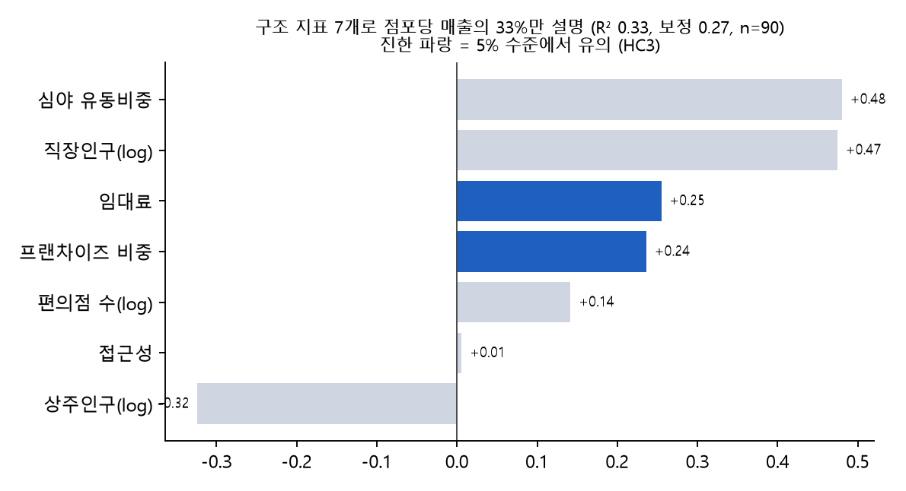

| 지표(표준화) | 계수 | 5% 유의(HC3) |
| :--- | ---: | :--- |
| 상주인구(log) | -0.32 | - |
| 접근성 | +0.01 | - |
| 편의점 수(log) | +0.14 | - |
| 프랜차이즈 비중 | +0.24 | 유의 |
| 임대료 | +0.25 | 유의 |
| 직장인구(log) | +0.47 | - |
| 심야 유동비중 | +0.48 | - |

7개 구조 지표로 설명되는 점포당 매출은 R² 0.33(보정 0.27)다. 지표끼리 상관이 커서 개별 계수는 조심해서 읽어야 한다. 입지 점수가 높아도 매출이 보장되지 않으므로 ROI 단계에서 실제 매출로 다시 확인한다.

### 5.6 비용 구조: 월세와 가맹 방식
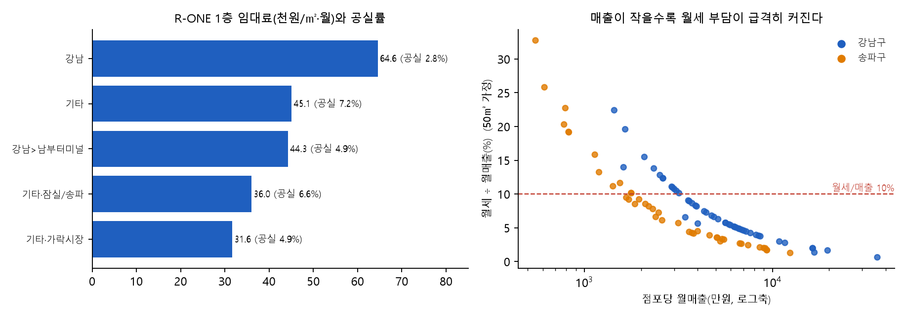

- 1층 임대료는 강남 권역 64.6, 송파 권역 약 34, 서초 약 45 천원/㎡·월로 강남이 송파의 약 1.9배다.
- 월세를 점포당 매출로 나눈 부담률은 매출이 작을수록 급격히 커진다.
- 가맹 타입은 <b>필요현금이 낮고(4천만원대) 본부가 임차하는 대신 배분율이 낮은 쪽(45–65%)</b>과 <b>필요현금이 높고(5,800만원 이상) 점주가 임차하는 대신 배분율이 높은 쪽(최대 80%)</b>으로 갈린다. A의 예산(5,000만원) 안에는 본부 임차형만 들어온다.

### 5.7 그 밖의 상권 분석
- 개폐업: 분기 평균 폐업률이 골목상권 4.3%, 발달상권 3.4%로 개업률(1.6%, 1.6%)의 2배 이상이다. 상권당 편의점 수는 전년 대비 골목 -7%, 발달 -6% 줄었다.
- 시간대·연령: 17–21시가 가장 크고 30대가 약 30%다.
- 상관: 점포당 매출은 직장인구·은행·사무 업소와 같이 커지고 남성 매출 비중이 높으면 작다. 경쟁밀도와는 오히려 양(+)의 관계다(수요가 검증된 곳에 점포가 몰린다). 아파트 세대수·접근성은 매출과 거의 무관하다.
- 구 격차는 구성 차이다: 같은 유형 안에서는 강남·송파 차이가 작다.

## 6. 입지 점수와 추천

### 6.1 가중치
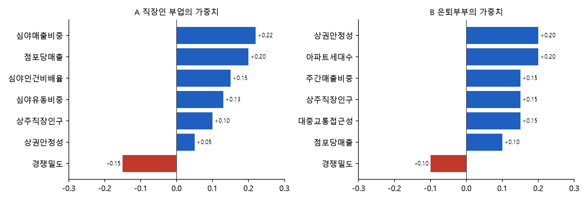

| A 지표 | 가중치 |
| :--- | ---: |
| 심야매출비중 | +0.22 |
| 점포당매출 | +0.20 |
| 심야인건비대비배율 | +0.15 |
| 심야유동비중 | +0.13 |
| 상주+직장인구 | +0.10 |
| 상권안정성(평균 영업개월) | +0.05 |
| 경쟁밀도(유동 10만명당 편의점, 감점) | -0.15 |

| B 지표 | 가중치 |
| :--- | ---: |
| 상권안정성(평균 영업개월) | +0.20 |
| 아파트세대수(경계 400m) | +0.20 |
| 주간매출비중 | +0.15 |
| 상주+직장인구 | +0.15 |
| 대중교통접근성 | +0.15 |
| 점포당매출 | +0.10 |
| 경쟁밀도(유동 10만명당 편의점, 감점) | -0.10 |

A는 심야 3지표 합이 0.50이라 밤에 강한 송파 골목·주거 상권이 올라오고, B는 안정성·세대수·접근성 합이 0.55라 안정된 생활권이 올라온다. 경쟁밀도 감점은 근거가 약하다(경쟁이 많은 곳의 매출이 오히려 높다)는 점을 팀도 인정한다.

### 6.2 페르소나 A: 입지 상위 5곳
| 입지 순위 | 상권 | 구 | 유형 | 점수 | 점포당 월매출(만원) | 심야매출비중 | 월수익(만원) | ROI | 판정 |
| ---: | :--- | :--- | :--- | ---: | ---: | ---: | ---: | ---: | :--- |
| 1 | 석촌고분역 4번 (소표본) | 송파구 | 골목상권 | 0.651 | 6,838 | 31% | 442 | 124% | 흑자 |
| 2 | 석촌고분역 1번 | 송파구 | 골목상권 | 0.639 | 5,406 | 37% | 210 | 59% | 흑자 |
| 3 | 방이동먹자골목 | 송파구 | 발달상권 | 0.637 | 8,574 | 40% | 725 | 204% | 흑자 |
| 4 | 논현초등학교 | 강남구 | 골목상권 | 0.622 | 6,281 | 39% | 352 | 99% | 흑자 |
| 5 | 삼전역 4번 | 송파구 | 골목상권 | 0.609 | 4,004 | 35% | -18 | -5% | **적자** |

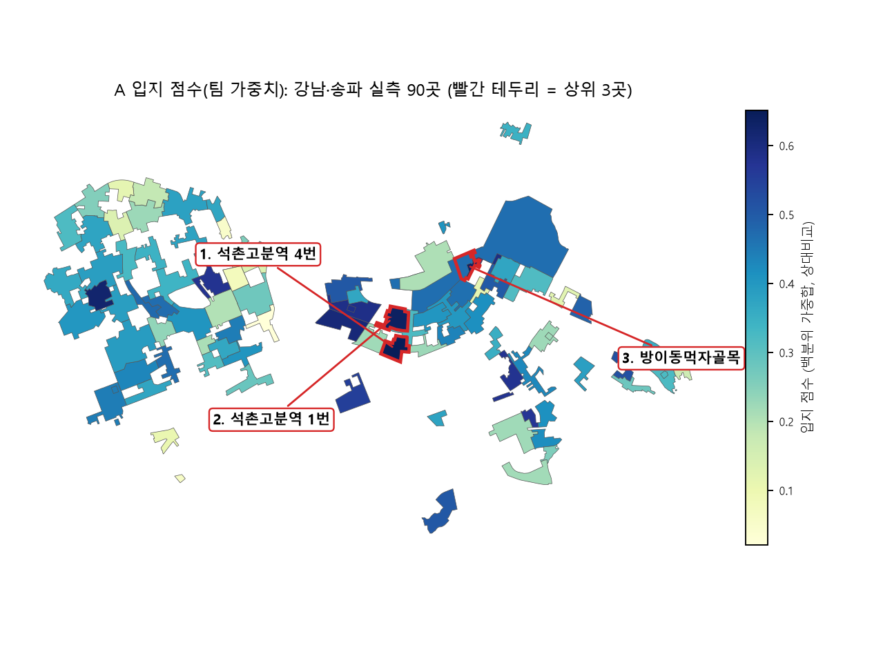

입지 1위 석촌고분역 4번은 편의점이 3곳뿐인 소표본이다. 상위 5곳 중 삼전역 4번은 알바비를 내면 월 순이익이 마이너스다. 상위 5곳은 모두 송파 삼전·석촌 일대와 논현초등학교 같은 골목상권이다.

### 6.3 페르소나 B: 후보 10곳의 입지 순위
| 입지 순위 | 상권 | 구 | 점수 | 점포당 월매출(만원) | 월수익(만원) | ROI | 판정 | ROI 추천 순위 |
| ---: | :--- | :--- | ---: | ---: | ---: | ---: | :--- | ---: |
| 1 | 뱅뱅사거리 | 강남구 | 0.595 | 8,452 | 928 | 261% | 흑자 | 2 |
| 2 | 양재역 | 서초구 | 0.530 | 1,983 | -143 | -23% | **적자** | - |
| 3 | 매봉역 | 강남구 | 0.520 | 2,115 | -123 | -20% | **적자** | - |
| 4 | 교육개발원입구사거리 (소표본) | 서초구 | 0.508 | 8,593 | 951 | 267% | 흑자 | 1 |
| 5 | 양재역 8번(양재동우체국) | 서초구 | 0.477 | 2,174 | -114 | -18% | **적자** | - |
| 6 | 도곡1동 | 강남구 | 0.447 | 2,941 | 32 | 9% | 흑자 | 5 |
| 7 | 포이사거리(삼호물산) | 서초구 | 0.442 | 7,222 | 728 | 205% | 흑자 | 3 |
| 8 | 개나리아파트 | 강남구 | 0.435 | 6,955 | 684 | 192% | 흑자 | 4 |
| 9 | 구역삼세무서 | 강남구 | 0.380 | 2,917 | 28 | 8% | 흑자 | 6 |
| 10 | 논현로18길 (소표본) | 강남구 | 0.340 | 1,614 | -200 | -32% | **적자** | - |

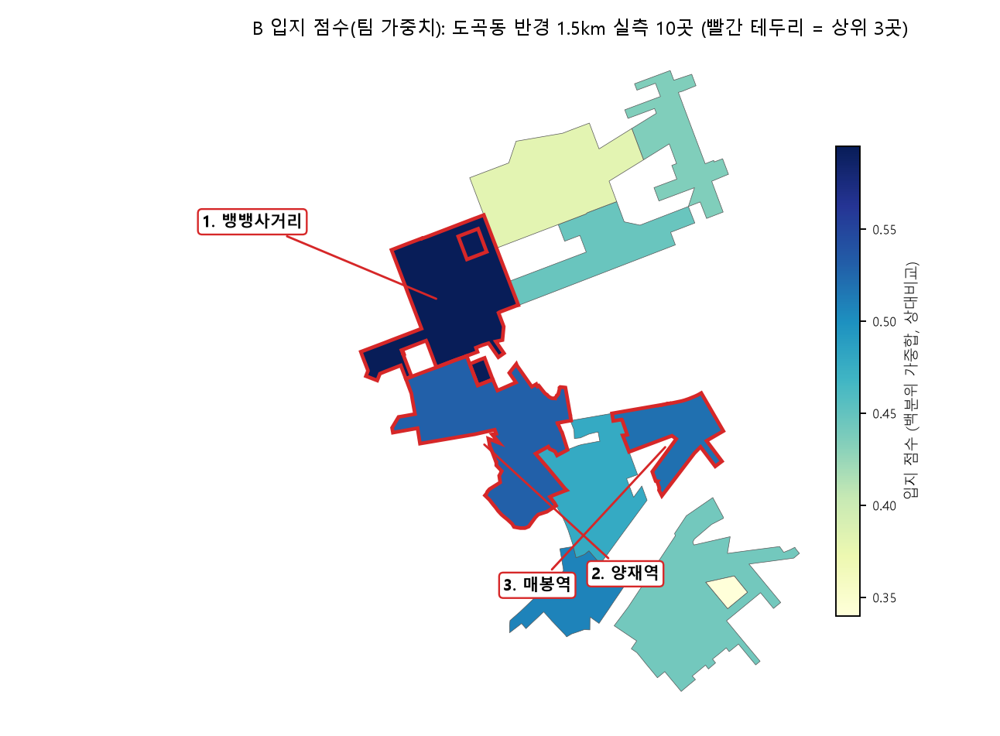

입지 2·3·5·10위(양재역·매봉역·양재역 8번·논현로18길)는 월 순이익이 마이너스다. B의 가중치에서 점포당 매출이 0.10뿐이라 사람·세대수로 순위가 오른 결과다.

### 6.4 가중치를 ±30% 흔들어도 상위권이 유지되는가
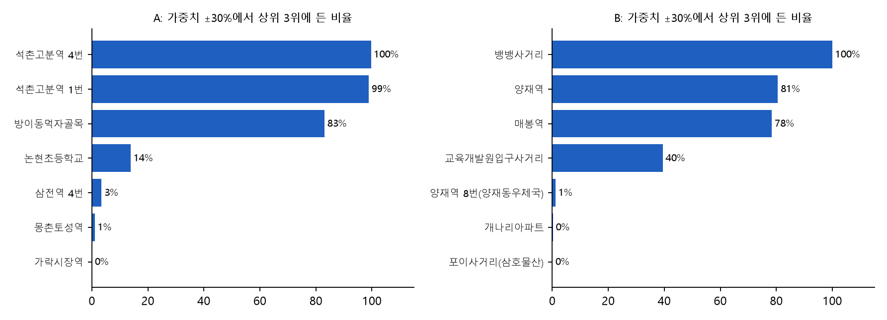

| A 상권 | 상위 3위에 든 비율 |
| :--- | ---: |
| 석촌고분역 4번 | 100% |
| 석촌고분역 1번 | 99% |
| 방이동먹자골목 | 83% |
| 논현초등학교 | 14% |
| 삼전역 4번 | 3% |
| 몽촌토성역 | 1% |

| B 상권 | 상위 3위에 든 비율 |
| :--- | ---: |
| 뱅뱅사거리 | 100% |
| 양재역 | 81% |
| 매봉역 | 78% |
| 교육개발원입구사거리 | 40% |
| 양재역 8번(양재동우체국) | 1% |
| 개나리아파트 | 0% |

## 7. ROI와 추천

### 7.1 얼마를 팔아야 남는가
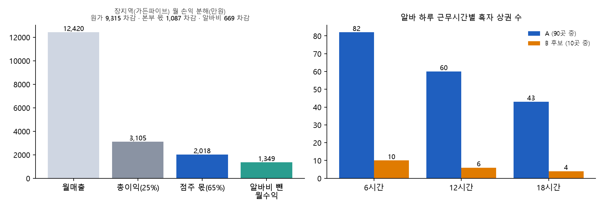

장지역(가든파이브)은 월매출 12,420만원에서 원가·본부 몫·알바비를 빼면 월 1,349만원이 남는다. 손익분기는 A(알바 18시간) 월 4,115만원, B(12시간) 월 2,744만원이다. A 90곳 중 47곳이 손익분기에 못 미친다. 알바 시간에 따라 흑자 상권 수가 크게 달라진다.

| 알바 하루 근무시간 | A 흑자(90곳 중) | B 흑자(10곳 중) |
| ---: | ---: | ---: |
| 6 | 82 | 10 |
| 12 | 60 | 6 |
| 18 | 43 | 4 |

### 7.2 페르소나 A: ROI 추천
| ROI 추천 순위 | 상권 | 구 | 점포당 월매출(만원) | 월수익(만원) | ROI(연) | 안전마진 | 심야매출비중 | 입지 순위 |
| ---: | :--- | :--- | ---: | ---: | ---: | ---: | ---: | ---: |
| 1 | 장지역(가든파이브) | 송파구 | 12,420 | 1,349 | 379% | 202% | 4% | 74 |
| 2 | 한티역 | 강남구 | 11,648 | 1,224 | 344% | 183% | 17% | 60 |
| 3 | 삼성역 | 강남구 | 10,892 | 1,101 | 309% | 165% | 7% | 64 |
| 4 | 가락시장역 | 송파구 | 9,347 | 850 | 239% | 127% | 26% | 8 |
| 5 | 문정역 1번 (소표본) | 송파구 | 9,316 | 845 | 238% | 126% | 26% | 10 |

점포당 매출 이상값 5곳은 ROI 순위 상위를 차지하지만 월매출 1.6–3.6억원이 현실적이지 않아 추천에서 제외하고 참고로만 둔다(입지 점수는 백분위라 이상값에 둔감하지만 ROI는 금액이라 그대로 왜곡된다).

| 상권(점포당 매출 이상값) | 구 | 점포당 월매출(만원) | ROI(참고) | 입지 순위 | ROI 순위 |
| :--- | :--- | ---: | ---: | ---: | ---: |
| 수서역 | 강남구 | 36,098 | 1,461% | 41 | 1 |
| 경복아파트교차로 | 강남구 | 19,709 | 712% | 17 | 2 |
| 윗방죽마을공원 | 강남구 | 16,911 | 584% | 13 | 3 |
| 은마아파트 | 강남구 | 16,386 | 560% | 32 | 4 |
| 강남 마이스 관광특구 | 강남구 | 16,347 | 559% | 63 | 5 |

**두 기준을 모두 통과하는 균형 후보**(입지 10위·ROI 15위 이내, 이상값 제외, 흑자):

| 상권 | 입지 순위 | ROI 순위 | 점포당 월매출(만원) | 심야매출비중 | 비고 |
| :--- | ---: | ---: | ---: | ---: | :--- |
| 방이동먹자골목 | 3 | 14 | 8,574 | 40% |  |
| 몽촌토성역 | 6 | 11 | 9,167 | 34% |  |
| 가락시장역 | 8 | 9 | 9,347 | 26% |  |
| 문정역 1번 | 10 | 10 | 9,316 | 26% | 소표본 |

### 7.3 페르소나 B: ROI 추천
| ROI 추천 순위 | 상권 | 구 | 점포당 월매출(만원) | 월수익(만원) | ROI(연) | 회수기간 | 안전마진 | 입지 순위 |
| ---: | :--- | :--- | ---: | ---: | ---: | ---: | ---: | ---: |
| 1 | 교육개발원입구사거리 (소표본) | 서초구 | 8,593 | 951 | 267% | 4.5개월 | 213% | 4 |
| 2 | 뱅뱅사거리 | 강남구 | 8,452 | 928 | 261% | 4.6개월 | 208% | 1 |
| 3 | 포이사거리(삼호물산) | 서초구 | 7,222 | 728 | 205% | 5.9개월 | 163% | 7 |

교육개발원입구사거리는 편의점 3곳뿐인 소표본이라 현장 확인이 먼저다. 후보 10곳 중 4곳(양재역·매봉역·양재역 8번·논현로18길)은 월세·인건비를 내면 적자다.

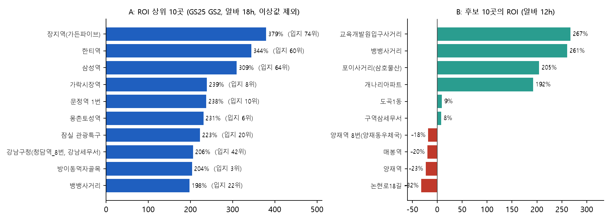

### 7.4 추천 매출은 분기별로도 일관된다
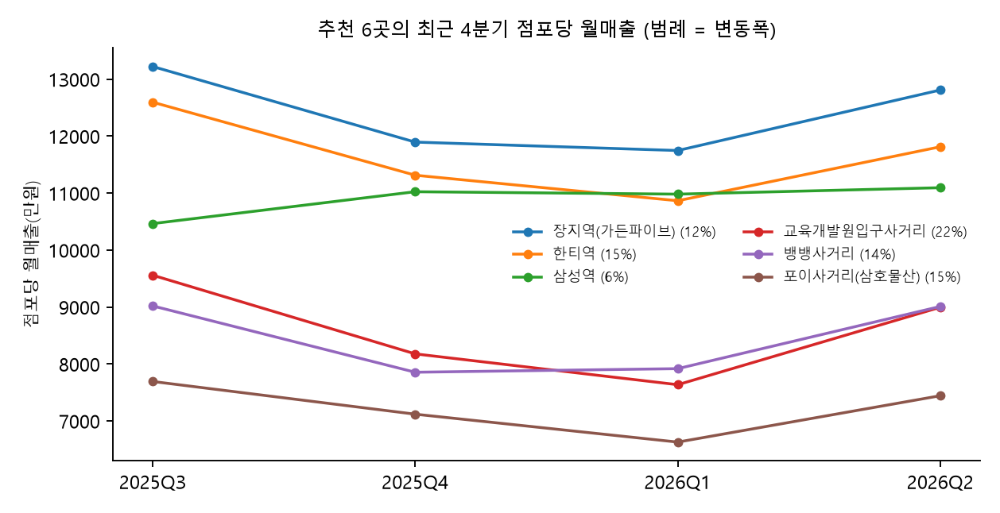

| 상권 | 2025Q3 | 2025Q4 | 2026Q1 | 2026Q2 | 변동폭 |
| :--- | ---: | ---: | ---: | ---: | ---: |
| 장지역(가든파이브) | 13,224 | 11,896 | 11,748 | 12,811 | 12% |
| 한티역 | 12,597 | 11,315 | 10,867 | 11,814 | 15% |
| 삼성역 | 10,465 | 11,025 | 10,982 | 11,096 | 6% |
| 교육개발원입구사거리 | 9,560 | 8,178 | 7,637 | 8,997 | 22% |
| 뱅뱅사거리 | 9,021 | 7,856 | 7,919 | 9,011 | 14% |
| 포이사거리(삼호물산) | 7,694 | 7,120 | 6,630 | 7,444 | 15% |

### 7.5 가정을 바꾸면 어떻게 되나
**페르소나 A**

| 시나리오 | 흑자 상권 | ROI 추천 3곳 | ROI | 선택된 가맹 타입 |
| :--- | ---: | :--- | :--- | :--- |
| 기본 | 43 | 장지역(가든파이브) · 한티역 · 삼성역 | 379% / 344% / 309% | GS25 GS2 / GS25 GS2 / GS25 GS2 |
| 총이익률 30% | 54 | 장지역(가든파이브) · 한티역 · 삼성역 | 493% / 450% / 409% | GS25 GS2 / GS25 GS2 / GS25 GS2 |
| 점주 노동 환산 | 35 | 장지역(가든파이브) · 한티역 · 삼성역 | 327% / 292% / 257% | GS25 GS2 / GS25 GS2 / GS25 GS2 |
| GS2 전대보증금 3,000만원 포함(발표 방식) | 35 | 장지역(가든파이브) · 한티역 · 삼성역 | 248% / 222% / 195% | 이마트24 NH 2 / 이마트24 NH 2 / 이마트24 NH 2 |
| 전·예치보증금이 있는 타입 모두 포함(확장) | 29 | 장지역(가든파이브) · 한티역 · 삼성역 | 205% / 180% / 156% | 세븐일레븐 B타입 / 세븐일레븐 B타입 / 세븐일레븐 B타입 |

**페르소나 B**

| 시나리오 | 흑자 상권 | ROI 추천 3곳 | ROI | 선택된 가맹 타입 |
| :--- | ---: | :--- | :--- | :--- |
| 기본 | 6 | 교육개발원입구사거리 · 뱅뱅사거리 · 포이사거리(삼호물산) | 267% / 261% / 205% | GS25 GS2 / GS25 GS2 / GS25 GS2 |
| 총이익률 30% | 6 | 교육개발원입구사거리 · 뱅뱅사거리 · 포이사거리(삼호물산) | 346% / 338% / 270% | GS25 GS2 / GS25 GS2 / GS25 GS2 |
| 점주 노동 환산 | 4 | 교육개발원입구사거리 · 뱅뱅사거리 · 포이사거리(삼호물산) | 163% / 156% / 100% | GS25 GS2 / GS25 GS2 / GS25 GS2 |
| GS2 전대보증금 3,000만원 포함(발표 방식) | 6 | 교육개발원입구사거리 · 뱅뱅사거리 · 포이사거리(삼호물산) | 201% / 172% / 145% | CU PURPLE 1  / 이마트24 NH 2 / CU PURPLE 1  |
| 전·예치보증금이 있는 타입 모두 포함(확장) | 6 | 교육개발원입구사거리 · 뱅뱅사거리 · 포이사거리(삼호물산) | 201% / 169% / 145% | CU PURPLE 1  / CU PURPLE 1  / CU PURPLE 1  |

- 총이익률 30%, 점주 본인 노동(최저임금 환산)을 비용으로 넣어도 추천 3곳의 이름과 순서는 같다. **이것은 ROI 순서가 점포당 매출 순서와 같기 때문**이라 독립적인 증거는 아니다(A는 투자금이 모든 상권에서 같아 상관 1.00). 가정이 바꾸는 것은 흑자 상권의 수와 ROI의 크기다.
- **전대보증금 시나리오는 두 가지로 돌렸다.** (1) 발표 방식: GS25 GS2의 전대보증금 3,000만원만 필요현금에 더한다. GS2는 7,270만원이 되어 A의 예산 5,000만원을 넘으므로 A는 이마트24 NH 2(배분율 51%, 필요현금 4,420만원)로 바뀌고 ROI는 248/222/195%, 흑자 상권은 35곳이다. (2) 확장: 전·예치보증금이 적힌 타입(GS2·GS3·이마트24 NH 2)에 모두 더한다. 그러면 A에게 남는 것은 세븐일레븐 B타입·안정투자형(가맹보증금 2,000만원이 담보와 같은 금액이라 더하지 않음, 배분율 45%)뿐이고 ROI는 205/180/156%, 흑자 상권은 29곳, 손익분기는 약 5,900만원이다. 두 경우 모두 추천 3곳의 이름과 순서는 같다. GS2 전대보증금이 담보와 별개인지는 원문 확인이 필요하다.

## 8. 결과 도출과 시사점

앞 장의 분석을 모아 두 창업자에게 어디를 추천하는지, 입지에 ROI를 더하면 무엇이 달라지는지 정리한다.

### 8.1 최종 추천과 핵심 결론

| 페르소나 | 입지만 고려한 상위 3곳 | ROI를 고려한 추천 3곳 |
| :--- | :--- | :--- |
| **A** 29세 직장인 부업 · 자금 5천만원 이내 · 심야·인건비 중시 | 석촌고분역 4번 · 석촌고분역 1번 · 방이동먹자골목 | 장지역(가든파이브) · 한티역 · 삼성역 |
| **B** 59세 은퇴부부 · 가용 2.5억 · 도곡동 반경 1.5km | 뱅뱅사거리 · 양재역 · 매봉역 | 교육개발원입구사거리 · 뱅뱅사거리 · 포이사거리(삼호물산) |

- **입지와 돈은 다른 질문이다.** A는 입지 상위 3곳과 ROI 추천 3곳이 하나도 겹치지 않고, B는 입지 2·3위(양재역·매봉역)가 월세·인건비를 내면 적자다.
- **비용 가정이 흑자 상권 수를 정한다.** 알바 하루 18시간(A)을 쓰면 90곳 중 43곳만 흑자이고, 6시간이면 82곳이 흑자다. B는 12시간에서 후보 10곳 중 6곳이 흑자다.
- **매출은 결제 건수가 가른다.** 점포당 매출 차이의 95%가 하루 결제 건수에서 나오고 객단가는 약 5%뿐이다.
- **시장은 구조조정 중이다.** 편의점 수가 정점(2023Q3)에서 -12.2% 줄었고(전년 대비 -5.8%), 남은 점포의 점포당 매출은 +3.7% 늘었다.
- **A의 심야 성향과 ROI는 충돌한다.** ROI 추천 3곳의 심야 매출 비중은 4–17%로 실측 중앙값(24%)보다 낮은 업무상권이다. 입지·ROI를 모두 통과하는 상권(7.2절)을 균형 후보로 함께 제시한다.
- **ROI 수치는 상한이다.** 전기료·폐기 손실·세금·점주 노동이 빠져 수백 %가 나온다. 순서와 안전마진(손익분기 대비 여유)으로 읽고 절대 수익으로 읽지 않는다.


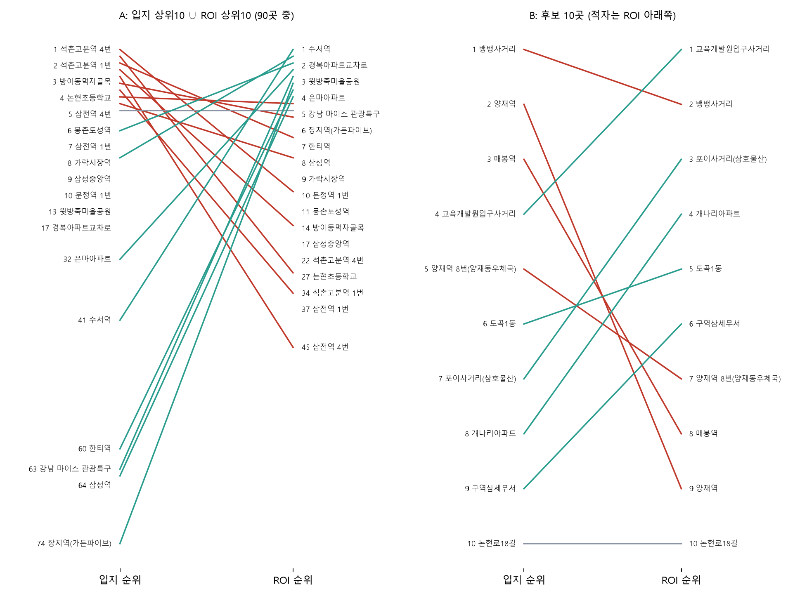

### 8.2 무엇이 바뀌었나
|  | 입지만 고려 | ROI 추가 |
| :--- | :--- | :--- |
| A 입지 상위 3 → ROI 추천 3 | 석촌고분역 4번 · 석촌고분역 1번 · 방이동먹자골목 | 장지역(가든파이브) · 한티역 · 삼성역 |
| B 입지 상위 3 → ROI 추천 3 | 뱅뱅사거리 · 양재역 · 매봉역 | 교육개발원입구사거리 · 뱅뱅사거리 · 포이사거리(삼호물산) |
| 묻는 질문 | 상권에 수요·접근·안정성·심야가 있는가 | 내 돈으로 월세·인건비를 내고 얼마가 남는가 |
| 핵심 지표 | 백분위 가중합 | 월매출 ÷ 손익분기, 투자금 대비 수익 |

### 8.3 왜 순위가 바뀌나
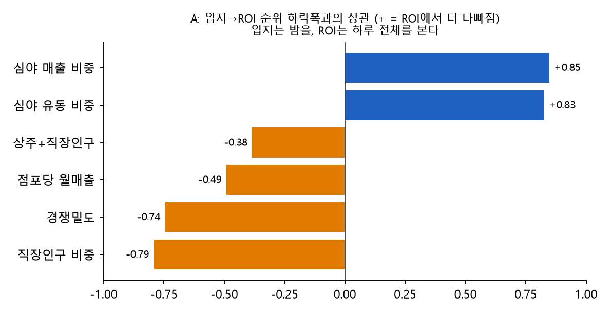

| 지표 | 순위 하락폭과의 상관 |
| :--- | ---: |
| 심야 매출 비중 | +0.85 |
| 심야 유동 비중 | +0.83 |
| 상주+직장인구 | -0.38 |
| 점포당 월매출 | -0.49 |
| 경쟁밀도 | -0.74 |
| 직장인구 비중 | -0.79 |

- **입지 점수는 밤을, ROI는 하루 전체를 본다.** 심야 매출 비중이 높은 상권일수록 ROI에서 크게 밀리고, 직장인구 비중이 큰 업무상권일수록 올라온다.
- **이상값이 ROI 위로 올라온다.** 입지는 백분위라 극단값이 눌리지만 ROI는 금액 그대로다.
- **비용이 적자 경계를 만든다.** A는 알바비 669만원이라 월매출 4,115만원 미만이면 적자이고, 골목상권 중앙값(2,311만원)은 이 선 아래다.
- **ROI 순위는 사실상 점포당 매출 순위다.** 그래서 ROI가 주는 새 정보는 순위보다 손익분기와 안전마진이다.

### 8.4 시사점
1. **상권 분석의 출발점은 성격이다.** 업무형과 주거형은 시간대·심야·점포당 매출 구조가 다르다.
2. **입지 점수만으로 추천하면 수익이 안 나는 곳을 고를 수 있다.** 최종 선택의 1순위는 ROI로 두고, 입지 점수는 수요의 지속성을 보는 보조 지표로 함께 보여준다.
3. **A는 돈과 성향이 부딪힌다.** ROI 상위는 업무상권이라 심야 선호와 맞지 않는다. 입지·ROI를 모두 통과하는 균형 후보를 함께 제시한다.
4. **B는 후보가 좁다.** 도곡동 생활권 안에서 흑자는 6/10곳이고 입지 상위 일부가 적자다. 반경 확대, 계약 조건 협상, 투자 보류를 선택지로 둔다.
5. **비용 가정 하나가 결론을 바꾼다.** 알바 시간·점주 노동·보증금은 사용자가 직접 넣게 한다(서비스의 알바 시간 슬라이더).
6. **이 추천은 '지금 잘 되는 곳' 목록이다.** 점포당 매출은 이미 운영 중인 점포의 결과이고 시장은 폐업률이 개업률을 웃돈다. 새 점포가 평균만큼 판다는 보장은 없다.

## 9. 발표 자료와 이 코드의 일치도

`scripts/team_*.py`는 발표 자료(`편의점_입지추천_최종발표`)의 정의로 숫자를 다시 만든다. `recommend.py`와 `analysis_*.py`는 이 코드의 입력(상권 단위 피처)을 만드는 앞 단계다. 점수·ROI 정의는 `team_spec.py`가 정한다.

### 9.1 입지 점수·세대수·ROI·손익분기
| 항목 | 대상 | 발표 자료 | 이 코드 | 판정 |
| :--- | :--- | ---: | ---: | :--- |
| A 입지 점수 | 석촌고분역 4번 | 0.651 | 0.651 | 일치 |
| A 입지 점수 | 석촌고분역 1번 | 0.64 | 0.639 | 일치 |
| A 입지 점수 | 방이동먹자골목 | 0.627 | 0.637 | 근접 |
| A 입지 점수 | 논현초등학교 | 0.624 | 0.622 | 근접 |
| A 입지 점수 | 삼전역 4번 | 0.609 | 0.609 | 일치 |
| B 입지 점수 | 뱅뱅사거리 | 0.595 | 0.595 | 일치 |
| B 입지 점수 | 양재역 | 0.53 | 0.53 | 일치 |
| B 입지 점수 | 매봉역 | 0.52 | 0.52 | 일치 |
| B 입지 점수 | 교육개발원입구사거리 | 0.508 | 0.508 | 일치 |
| B 입지 점수 | 양재역 8번(양재동우체국) | 0.478 | 0.478 | 일치 |
| B 아파트 세대수(경계 400m) | 뱅뱅사거리 | 8,798 | 8,798 | 일치 |
| B 아파트 세대수(경계 400m) | 양재역 | 6,861 | 6,861 | 일치 |
| B 아파트 세대수(경계 400m) | 매봉역 | 1,965 | 1,965 | 일치 |
| B 아파트 세대수(경계 400m) | 교육개발원입구사거리 | 641 | 641 | 일치 |
| B 아파트 세대수(경계 400m) | 양재역 8번(양재동우체국) | 2,088 | 2,088 | 일치 |
| B 아파트 세대수(경계 400m) | 도곡1동 | 6,417 | 6,417 | 일치 |
| B 아파트 세대수(경계 400m) | 포이사거리(삼호물산) | 2,471 | 2,471 | 일치 |
| B 아파트 세대수(경계 400m) | 개나리아파트 | 7,941 | 7,941 | 일치 |
| B 아파트 세대수(경계 400m) | 구역삼세무서 | 3,158 | 3,158 | 일치 |
| B 아파트 세대수(경계 400m) | 논현로18길 | 175 | 175 | 일치 |
| A 입지 TOP5 월 순이익(만원) | 석촌고분역 4번 | 442 | 442 | 일치 |
| A 입지 TOP5 월 순이익(만원) | 석촌고분역 1번 | 210 | 210 | 일치 |
| A 입지 TOP5 월 순이익(만원) | 방이동먹자골목 | 725 | 725 | 일치 |
| A 입지 TOP5 월 순이익(만원) | 논현초등학교 | 352 | 352 | 일치 |
| A 입지 TOP5 월 순이익(만원) | 삼전역 4번 | -18 | -18 | 일치 |
| B 입지 TOP5 월 순이익(만원) | 뱅뱅사거리 | 928 | 928 | 일치 |
| B 입지 TOP5 월 순이익(만원) | 양재역 | -143 | -143 | 일치 |
| B 입지 TOP5 월 순이익(만원) | 매봉역 | -123 | -123 | 일치 |
| B 입지 TOP5 월 순이익(만원) | 교육개발원입구사거리 | 951 | 951 | 일치 |
| B 입지 TOP5 월 순이익(만원) | 양재역 8번(양재동우체국) | -114 | -114 | 일치 |
| A ROI(%) | 장지역(가든파이브) | 379 | 379 | 일치 |
| A ROI(%) | 한티역 | 344 | 344 | 일치 |
| A ROI(%) | 삼성역 | 309 | 309 | 일치 |
| B ROI(%) | 교육개발원입구사거리 | 267 | 267 | 일치 |
| B ROI(%) | 뱅뱅사거리 | 261 | 261 | 일치 |
| B ROI(%) | 포이사거리(삼호물산) | 205 | 205 | 일치 |
| A 손익분기(만원) | GS25 GS2·18h | 4,115 | 4,115 | 일치 |
| B 손익분기(만원) | GS25 GS2·12h | 2,744 | 2,744 | 일치 |
| A 흑자 상권 수 | 90곳 중 | 43 | 43 | 일치 |
| B 흑자 상권 수 | 10곳 중 | 6 | 6 | 일치 |

- B 입지 점수 5곳과 아파트 세대수 10곳, A·B ROI와 손익분기, 흑자 상권 수는 **발표 자료와 소수점까지 같다**.
- A 입지 점수는 5곳 순서와 4곳의 점수가 같고, 방이동먹자골목만 0.637(발표 0.627)이다. 이 한 곳 때문에 A의 Top3 빈도(방이동먹자골목 83%, 발표 59%)와 A ROI 추천 3곳의 입지 순위(발표 71·60·64위, 이 코드 74·60·64위)도 조금 다르다.

### 9.2 보조 분석
| 항목 | 발표 자료 | 이 코드 | 판정 |
| :--- | :--- | :--- | :--- |
| 점포 수 정점→최근 | 1,125 → 988 | 1,125 → 988 | 일치 |
| 전년 대비 점포 / 매출 / 점포당 매출 | -5.8% / -2.3% / +3.7% | -5.8% / -2.3% / +3.7% | 일치 |
| 하루 결제 건수 상위20% / 하위20% | 345건 / 95건 | 345건 / 95건 | 일치 |
| 점포당 월매출 상위20% / 하위20% | 7,284만 / 1,936만 | 7,284만 / 1,936만 | 일치 |
| 매출 분산 중 결제 건수가 설명하는 몫 | 95% | 95% | 일치 |
| 결제 건수와 점포당 매출 순위상관 | +0.97 | +0.97 | 일치 |
| 군집 k=2: 크기와 실루엣 | 52 / 38곳, 0.37 | 52 / 38곳, 0.37 | 일치 |
| 군집별 점포당 월매출 중앙값 | 5,583만 / 2,367만 | 5,583만 / 2,367만 | 일치 |
| 심야 유동 vs 심야 매출 순위상관 / 유동>매출 상권 수 | +0.74 / 81곳 | +0.75 / 83곳 | 근접 |
| 순위 하락폭 상관(심야 매출비중 / 직장인구 비중) | +0.85 / -0.79 | +0.85 / -0.79 | 일치 |
| 구조 지표 OLS R² (보정 R²) | 0.36 (0.30) | 0.33 (0.27) | **차이**(지표 정의가 달랐던 것으로 보임) |
| 알바 6/12/18시간별 A 흑자 상권 | 82 / 60 / 43곳 | 82 / 60 / 43곳 | 일치 |
| 알바 6/12/18시간별 B 흑자 상권 | 10 / 6 / 4곳 | 10 / 6 / 4곳 | 일치 |
| A ROI 민감도(장지역: 기본/총이익률30%/점주노동) | 379% / 493% / 327% | 379% / 493% / 327% | 일치 |
| B ROI 민감도(교육개발원: 기본/총이익률30%/점주노동) | 267% / 346% / 163% | 267% / 346% / 163% | 일치 |
| GS2 전대보증금 포함 시 A ROI(장지역·한티역·삼성역) | 248% / 222% / 195% (이마트24 NH 2) | 248% / 222% / 195% (이마트24 NH 2) | 일치 |
| GS2 전대보증금 포함 시 B ROI(교육개발원·뱅뱅·포이) | 201% / 172% / 145% | 201% / 172% / 145% | 일치 |
| 추천 6곳 분기 변동폭 | 6–22% | 6–22% | 일치 |

재현하지 못했거나 다르게 나온 것: OLS의 R²(0.33 대 0.36)와 개별 계수, 심야 유동>매출 상권 수(83 대 81), A 입지 점수의 방이동먹자골목 한 곳(0.637 대 0.627)과 거기서 이어지는 A Top3 빈도·A ROI 추천 상권의 입지 순위(74 대 71위). 월 순이익(적자 상권 포함)과 전대보증금 시나리오는 가맹 타입 선택 규칙을 발표 자료와 같이 맞춘 뒤 모두 일치한다.

## 10. 한계와 확인할 것

- **ROI는 상한 추정이다.** 전기료·수도료·폐기 손실·4대보험·세금·B의 인테리어 비용이 빠져 있고 점주 본인 노동은 무급이다. 투자금이 작은 본부 임차형이 선택되어 수백 %가 나온다.
- **GS25 GS2 전대보증금 3,000만원**이 담보와 별개인지 가맹 안내 원문으로 확인되지 않았다. 별개라면 GS2는 A의 예산 5,000만원을 넘고 A의 흑자 상권은 35곳(이마트24 NH 2로 대체)으로 줄어든다. GS3·NH 2의 예치보증금까지 같은 성격이면 29곳(세븐일레븐 B타입)이다(7.5절).
- **소표본:** 석촌고분역 4번(편의점 3.0곳), 교육개발원입구사거리(3.0곳), 문정역 1번(3.0곳) 등은 점포당 매출이 불안정하다. 현장 확인이 먼저다.
- **점포당 매출 이상값 5곳**(수서역, 경복아파트교차로, 윗방죽마을공원, 은마아파트, 강남 마이스 관광특구)은 ROI 추천에서 제외했다.
- 매출 비공개 상권(매출불명)은 평가하지 못했다. 경쟁이 적은 기회일 수 있어 현장 조사나 카드사 데이터로 보완해야 한다.
- 임대료는 권역 평균을 구 단위로 임시 매핑한 값이고, 월세 계산의 면적(66㎡)·보증금·권리금은 가정이다.
- 담배소매인 지정 거리 제한(출점 가능성)은 반영하지 못했다. 출점 전 관할 구청 확인이 필수다.
- 인구·집객시설 원천 기준 시점(2020–2024)이 최근 분기와 다르고, 공동주택은 관리정보시스템 가입 단지만 포함한다.
- 신규 출점이 기존 점포 매출을 얼마나 깎는지(상권 잠식)는 알 수 없다.
- **서비스 앱**(`src/app/streamlit_app.py`, 발표 자료 19번 슬라이드)과 팀이 쓴 원본 계산 코드는 이 저장소 폴더에 없다. 이 저장소의 `team_*.py`는 발표 자료의 정의를 따라 다시 만든 재현 코드다.

## 11. 코드와 실행 방법

### 11.1 처음 받은 PC에서 처음부터 실행하기

Git과 Python(3.14에서 확인함)만 있으면 이 저장소만으로 원천 데이터 복원부터 결과 재현까지 할 수 있다.

```bash
git clone https://github.com/jwoochoi2001/DA_Convenience-Store-Site-Recommender.git
cd DA_Convenience-Store-Site-Recommender
pip install -r requirements.txt
python scripts/setup_data.py   # data_bundle/ 조각을 SHA256으로 확인하고 합쳐 data/ 복원
cd scripts
python recommend.py && python analysis_expand.py && python analysis_pipeline.py
python team_panel.py && python team_features.py && python team_score_roi.py && python team_extra.py
python build_readme.py         # 이 문서까지 다시 만든다
```

결과 파일(`eda_output/`)과 그림은 이미 저장소에 들어 있어서, 데이터 복원 없이 README와 그림만 보는 것은 `git clone`만으로 된다.

### 11.2 단계별 실행

```bash
pip install -r requirements.txt
cd scripts
python analysis_expand.py       # 확장 지표 → eda_output/analysis/feature_extended.csv (team_* 코드의 입력, 먼저 필요)
python recommend.py             # 기본 피처 → eda_output/feature_table_gangnam_songpa.csv (analysis_expand.py의 입력)
python analysis_pipeline.py     # 상권 분석 기초 지표(개폐업·상관·임대료), 지도 그리기 함수. results.pkl은 build_readme.py가 개폐업 수치에 쓴다
python team_panel.py            # 분기 패널(상권×분기 매출·점포)
python team_features.py         # 팀 정의 피처(경계 400m 세대수, 경쟁밀도 …)
python team_score_roi.py        # 입지 점수 + ROI + 발표 자료 대조(validation.csv)
python team_extra.py            # 시장 시계열·결제 건수·군집·OLS·민감도 + 그림 t01–t14
python crop_deck_slides.py "<발표 PDF 경로>"   # 14절의 장표 그림(eda_output/deck/)을 PDF에서 다시 자른다
python build_readme.py          # 이 문서 재생성
```

선행 조건: `data/` 아래에 원천 데이터(`docs/데이터_README.md`의 파일 구조), 서초 추가분은 `data/data_go_kr/12_13_18_공동주택/공동주택_서초_*.csv`와 `14_소상공인_상가정보/상가정보_서초.csv`. `analysis_expand.py`를 다시 돌리지 않으려면 `eda_output/analysis/feature_extended.csv`가 있어야 한다.

**입력 준비(원천 → 상권 단위 지표 표)**

| 파일 | 역할 |
| :--- | :--- |
| `data_paths.py` | 원천 데이터 로더(전부 문자열로 읽음) |
| `geo_utils.py` | 좌표 변환(EPSG:5181↔WGS84), 반경 계산, 백분위·IQR 도우미 |
| `recommend.py` | 상권 단위 기본 피처 테이블(`eda_output/feature_table_gangnam_songpa.csv`) 생성 |
| `analysis_expand.py` | 확장 피처 테이블(`feature_extended.csv`): 서초 포함, 임대료 매핑, 인구·집객시설 지표 |
| `analysis_pipeline.py` | 개폐업·상관 분석과 상권 지도 그리기 함수(`team_extra.py`가 사용) |
| `profile_all.py` | 원천 데이터 프로파일링(`docs/원천데이터_프로파일.md`) |

**발표 자료 재현(점수·ROI·검증)**

| 파일 | 역할 |
| :--- | :--- |
| `team_spec.py` | **팀 발표 자료의 가중치·가정·검증 기준값.** 값을 바꾸면 다른 가정으로 다시 돌릴 수 있다 |
| `team_panel.py` | 상권×분기 패널(2021Q1–2026Q2): 점포당 매출, 결제 건수, 점포 수 |
| `team_features.py` | 팀 정의 피처: 점포당 매출(분기 평균), 경계 400m 세대수(서초 포함), 경쟁밀도, 안정성, 심야 유동 |
| `team_score_roi.py` | 입지 점수, 가맹 타입 최적 선택, 월 순이익·ROI·손익분기, 발표 자료 대조 |
| `team_extra.py` | 시장 시계열, 결제 건수 분해, 군집 k=2, OLS, 순위 하락폭, 분기 안정성, 민감도, 그림 |

**장표·문서**

| 파일 | 역할 |
| :--- | :--- |
| `crop_deck_slides.py` · `readme_deck_section.py` | 발표 PDF에서 장표 본문을 잘라 `eda_output/deck/`에 저장 · 14절의 장표별 설명 텍스트 |
| `build_readme.py` | 이 문서 생성 |

## 12. 폴더 구조

```
README.md                  이 문서
requirements.txt, .gitignore
docs/                      데이터_README.md(수집 출처·파일 형식·알려진 한계), 전처리_기준서.md(v3), 파일목록.csv(원천 파일 SHA256), 서초추가_README.md·서초추가_파일목록.csv, 원천데이터_프로파일.md
presentation/              최종 발표 자료(46장 PDF)
scripts/                  분석 코드(위 표)
data_bundle/               원천 데이터 zip 조각 5개와 SHA256SUMS.txt(`scripts/setup_data.py`로 풀면 data/)
data/                      setup_data.py가 만드는 원천 데이터(.gitignore, 저장소에는 없음)
eda_output/
  analysis/                feature_extended.csv(확장 피처), fig_04_rent.png
  deck/                    발표 PDF 장표 크롭 slideNN.png (README 14절)
  team/                    팀 발표 재현 결과: feature_team.csv, roi_A/B.csv, score_A/B.csv, validation.csv, quarterly_panel.csv, 그림 t01–t14
```

## 13. 그림 모음

5·6·7·8절에서 설명한 그림 14장(`eda_output/team/`)을 한곳에 모았다. 모두 `team_extra.py`가 원천 데이터에서 만든다.

**t01 시장 국면**


실측 90개 상권의 편의점 수 합계(왼쪽)는 2023년 3분기 정점 1,125곳에서 2026Q2 988곳으로 -12.2% 줄었다. 오른쪽은 전년 동기(2025Q2) 대비 변화다: 점포 -5.8%, 상권 매출 -2.3%, 점포당 매출 +3.7%. 점포가 매출보다 빨리 줄어서 남은 점포의 점포당 매출은 늘었다(구조조정).

**t02 매출은 결제 건수가 가른다**


가로=점포 1곳의 하루 결제 건수, 세로=점포당 월매출(둘 다 로그축). 거의 직선이다(순위상관 +0.97). 로그 매출의 분산 중 결제 건수가 95%, 객단가가 나머지 약 5%를 설명한다. 하루 결제 건수는 상위 20% 상권 345건, 하위 20% 95건(3.6배), 점포당 월매출은 7,284만 대 1,936만원(3.8배)이다. 매출을 키우는 것은 단가가 아니라 손님 수다.

**t03 상권 유형 군집(k=2)**


직장인구 비중·심야 유동 비중·상주+직장인구·점포수·접근성 5개 지표로 나눈 두 군집이다(매출은 입력에 넣지 않음, 실루엣 0.37). 직장·번화형 52곳은 점포당 월매출 중앙값 5,583만원·심야 비중 20%, 주거·골목형 38곳은 2,367만원·29%다.

**t04 구조 지표의 설명력(OLS)**


상주인구·접근성·편의점 수·프랜차이즈 비중·임대료·직장인구·심야 유동 비중 7개로 로그 점포당 매출을 회귀했다(표준화 계수, HC3 표준오차). R²는 0.33(보정 0.27, n=90)로, 구조 지표만으로는 매출의 약 3분의 1만 설명된다. 나머지는 개별 입지 요인이라 입지 점수만으로 매출을 보장할 수 없고 ROI로 따로 확인해야 한다. 발표 자료의 R² 0.36과 약간 다르다(지표 정의 차이).

**t05 밤 유동은 밤 매출이 되는가**


왼쪽 산점도는 심야 매출 비중(가로)과 심야 유동 비중(세로). 점선(유동=매출) 위에 있는 상권이 83/90곳으로 대부분 유동이 매출보다 많다. 두 지표는 같은 방향이지만(순위상관 +0.75) 유동 30% → 매출 약 24%로, 밤 유동을 곧바로 밤 수익으로 보면 과대평가다. 오른쪽은 상권구분별 중앙값이다.

**t06 입지에서 ROI로 순위가 떨어지는 이유(A)**


A 90곳에서 '입지 순위 → ROI 순위 하락폭'과 각 지표의 Spearman 상관이다(+ = ROI에서 더 나빠짐). 심야 매출 비중(+0.85)·심야 유동 비중이 높은 상권이 ROI에서 많이 밀리고, 직장인구 비중·경쟁밀도·점포당 월매출이 큰 상권은 오히려 올라온다. 입지 점수는 밤에 강한 곳을, ROI는 하루 전체 매출을 본다는 뜻이다.

**t07 추천 6곳의 분기 안정성**


추천 상권 6곳의 최근 4개 분기 점포당 월매출이다(범례의 %는 (최대−최소)÷평균). 변동폭이 6–22%로 매출이 한 분기에 몰려 있지 않고, 손익분기(A 4,115만, B 2,744만원)를 모든 분기에서 넘는다.

**t08 입지 점수 가중치**


A는 심야 3지표(심야매출비중 .22, 심야인건비대비배율 .15, 심야유동비중 .13)의 합이 0.50이고 점포당 매출 .20, 경쟁밀도 −.15(감점)다. B는 안정성 .20, 아파트 세대수 .20, 접근성 .15, 인구 .15, 주간 비중 .15로 점포당 매출은 .10뿐이다. 두 가중치가 다르기 때문에 같은 상권이 A와 B에서 다른 순위가 된다.

**t09 ROI 상위(A)와 후보 전체(B)**


왼쪽은 A의 ROI 상위 10곳(이상값 제외)과 각 상권의 입지 순위, 오른쪽은 B 후보 10곳의 ROI다. A는 입지 순위가 낮은 업무상권(장지역 74위 등)이 ROI 상위를 차지한다. B는 양재역·매봉역·양재역 8번·논현로18길이 마이너스(빨강)다.

**t10 월 손익 분해와 알바 시간별 흑자 상권**


왼쪽은 장지역(가든파이브)의 월 손익이다. 월매출 12,420만 → 총이익(25%) 3,105만 → 점주 몫(65%) 2,018만 → 알바비(18시간) 669만원을 빼면 월수익 1,349만원이다. 오른쪽은 알바 하루 근무시간이 6/12/18시간일 때 흑자 상권 수로, A는 82/60/43곳, B는 10/6/4곳으로 줄어든다. 비용 가정 하나가 흑자 상권 수를 크게 움직인다.

**t11 입지 순위 → ROI 순위**


초록=ROI에서 순위 상승, 빨강=하락, 회색=변동 없음. A는 입지 1–5위(석촌고분역·방이동먹자골목 등)가 ROI 14–45위로 내려가고 수서역·경복아파트교차로 같은 이상값과 장지역·한티역·삼성역이 올라온다. B는 입지 2·3위(양재역·매봉역)가 ROI 8·9위(적자)로 떨어지고 입지 4위 교육개발원입구사거리가 ROI 1위가 된다.

**t13 A 입지 점수 지도(팀 가중치)**


강남·송파 실측 90곳을 팀 가중치로 만든 A 입지 점수(진할수록 높음)로 칠한 지도이고 빨간 테두리가 상위 3곳(석촌고분역 4번·1번, 방이동먹자골목)이다. 상위권이 송파 삼전·석촌 일대 골목상권에 몰려 있다. 왼쪽 덩어리가 강남, 오른쪽이 송파다.

**t14 B 입지 점수 지도(팀 가중치)**


도곡동 중심점 반경 1.5km 실측 10곳의 B 입지 점수 지도다(상위 3곳: 뱅뱅사거리, 양재역, 매봉역). 1위 뱅뱅사거리가 가장 진하고, 2·3위는 그 남쪽(양재·매봉)이다. 이 3곳 중 2·3위는 ROI 단계에서 적자로 탈락한다.

**t12 가중치를 흔들어도 상위권이 유지되는가**


각 가중치를 ±30% 범위에서 무작위로 3,000번 바꿔 상위 3위에 든 비율이다. B는 뱅뱅사거리가 100%, 양재역·매봉역이 약 80%로 안정적이다. A는 석촌고분역 4번·1번이 거의 100%이고 3위는 방이동먹자골목과 논현초등학교가 갈린다.

## 14. 발표 자료 장표별 시각화와 근거

5–8절의 코드 그림으로 설명되지 않던 발표 장표(번호는 `편의점_입지추천_최종발표` PDF의 슬라이드 번호)를 정리했다. **그림은 발표 PDF에서 해당 장표의 본문만 잘라낸 이미지**(`eda_output/deck/slideNN.png`)이고, 설명의 숫자는 발표 자료에 적힌 값이다. 이 저장소 코드가 같은 값을 다시 만드는지는 9절에서 확인한다.

### 슬라이드 3 · 서비스를 만든 이유: 입지만 보면 내게 최선인지 알 수 없다
*도입*

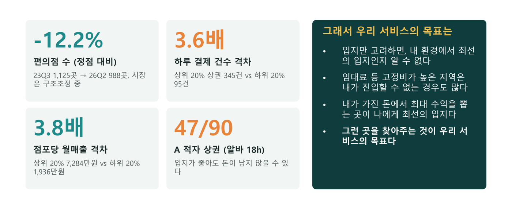

- 편의점 수는 정점(23Q3) 1,125곳에서 26Q2 988곳으로 -12.2%다. 시장은 구조조정 중이다.
- 하루 결제 건수 격차 3.6배(상위 20% 상권 345건 대 하위 20% 95건), 점포당 월매출 격차 3.8배(7,284만원 대 1,936만원).
- A 조건(알바 하루 18시간)으로 계산하면 90곳 중 47곳이 적자다. 입지가 좋아도 돈이 남지 않을 수 있다.
- 서비스 목표: 입지만 고려하면 내 환경에서 최선의 입지인지 알 수 없다. 임대료 등 고정비가 높은 지역은 내가 진입할 수 없는 경우도 많다. 내가 가진 돈에서 최대 수익을 뽑는 곳이 나에게 최선의 입지이고, 그런 곳을 찾아주는 것이 목표다.
- 출처: 서울시 상권분석서비스 분기 패널 2021Q1–2026Q2, 실측 90곳(강남·송파). 매출은 카드 보정 추정(명목).

### 슬라이드 8 · 왜 데이터로 봐야 하나: 좋은 상권은 하나가 아니다
*도입*

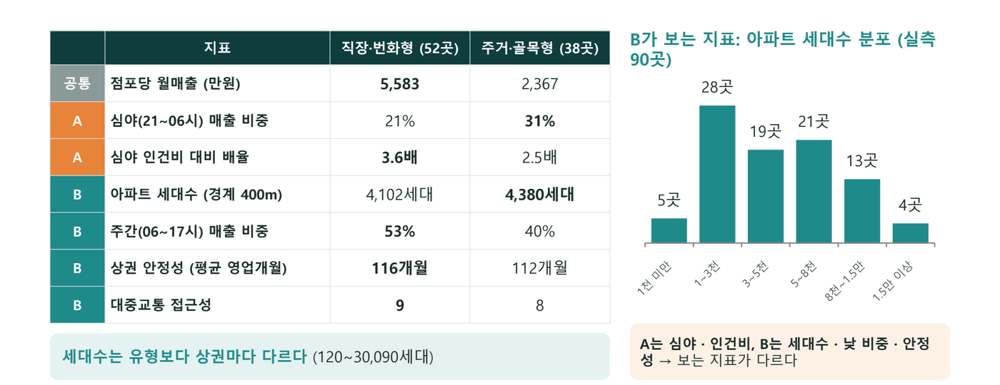

- 상권을 직장·번화형(52곳)과 주거·골목형(38곳)으로 나누면 점포당 월매출이 5,583만원 대 2,367만원이다.
- A가 보는 지표: 심야(21–06시) 매출 비중 21% 대 31%, 심야 인건비 대비 배율 3.6배 대 2.5배.
- B가 보는 지표: 아파트 세대수(경계 400m) 4,102 대 4,380세대, 주간(06–17시) 매출 비중 53% 대 40%, 상권 안정성 116 대 112개월, 대중교통 접근성 9 대 8.
- 세대수는 유형보다 상권마다 다르다(120–30,090세대). 오른쪽 그림은 실측 90곳의 세대수 분포로, 1천 미만 5곳, 1–3천 28곳, 3–5천 19곳, 5–8천 21곳, 8천–1.5만 13곳, 1.5만 이상 4곳이다.
- 결론: A는 심야·인건비, B는 세대수·낮 비중·안정성을 본다. 조건이 다르면 봐야 할 지표도 다르다. (군집: 5개 지표 k-means k=2, 실루엣 0.37)

### 슬라이드 11 · 편의점 매출은 결제 건수가 견인한다
*데이터 분석*

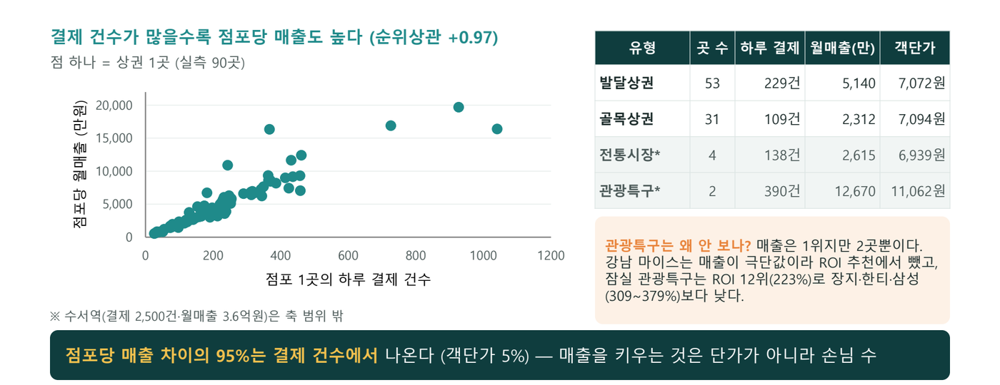

- 점 하나가 상권 1곳이고 결제 건수가 많을수록 점포당 매출도 높다(순위상관 +0.97). 수서역(결제 2,500건, 월매출 3.6억원)은 축 범위 밖이다.
- 유형별(곳 수 / 하루 결제 / 월매출 / 객단가): 발달상권 53곳·229건·5,140만·7,072원, 골목상권 31곳·109건·2,312만·7,094원, 전통시장 4곳·138건·2,615만·6,939원, 관광특구 2곳·390건·12,670만·11,062원.
- **관광특구는 왜 안 보나?** 매출은 1위지만 2곳뿐이다. 강남 마이스는 매출이 극단값이라 ROI 추천에서 뺐고, 잠실 관광특구는 ROI 12위(223%)로 장지·한티·삼성(309–379%)보다 낮다.
- 점포당 매출 차이의 95%는 결제 건수에서 나온다(객단가 5%). 매출을 키우는 것은 단가가 아니라 손님 수다.

### 슬라이드 12 · 낮에 강한 직장·번화형과 밤에 강한 주거·골목형
*데이터 분석*

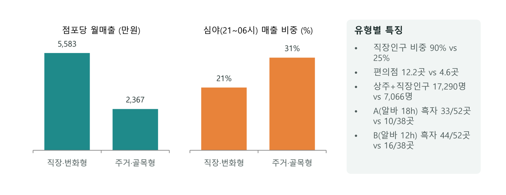

- 직장·번화형 52곳은 점포당 월매출 5,583만원·심야 매출 비중 21%, 주거·골목형 38곳은 2,367만원·31%다.
- 직장인구 비중 90% 대 25%, 편의점 수 12.2곳 대 4.6곳, 상주+직장인구 17,290명 대 7,066명.
- A(알바 18h) 흑자 상권: 직장·번화형 33/52곳, 주거·골목형 10/38곳. B(알바 12h) 흑자 상권: 44/52곳 대 16/38곳.
- 군집 입력은 직장인구 비중·심야 유동·인구·점포수·접근성이고 매출은 넣지 않았다.

### 슬라이드 17 · A의 조건에서 가중치가 나왔다: 밤에 일하는 직장인
*입지 점수 · A*

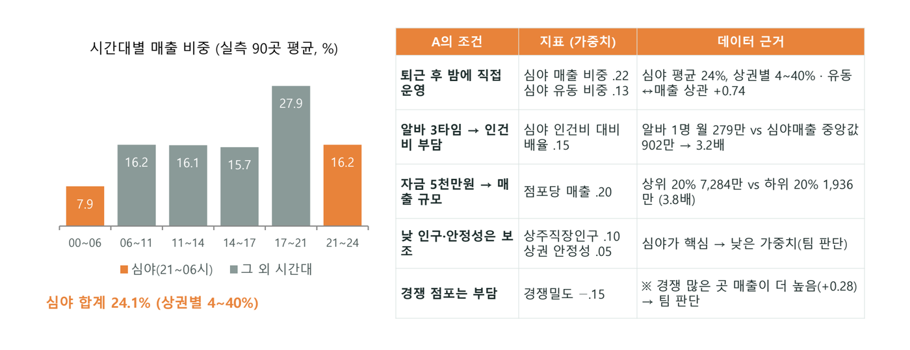

- 시간대별 매출 비중(실측 90곳 평균): 00–06시 7.9%, 06–11시 16.2%, 11–14시 16.1%, 14–17시 15.7%, 17–21시 27.9%, 21–24시 16.2%. 심야(21–06시) 합계는 24.1%이고 상권별로 4–40%다.
- 퇴근 후 밤에 직접 운영 → 심야 매출 비중 .22, 심야 유동 비중 .13 (심야 평균 24%, 상권별 4–40%, 유동과 매출의 상관 +0.74).
- 알바 3타임 → 인건비 부담 → 심야 인건비 대비 배율 .15 (알바 1명 월 279만원 대 심야매출 중앙값 902만원 = 3.2배).
- 자금 5천만원 → 매출 규모 → 점포당 매출 .20 (상위 20% 7,284만원 대 하위 20% 1,936만원, 3.8배).
- 낮 인구·안정성은 보조: 상주직장인구 .10, 상권 안정성 .05 (심야가 핵심이라 낮은 가중치, 팀 판단).
- 경쟁 점포는 부담: 경쟁밀도 -.15. 다만 경쟁이 많은 곳의 매출이 더 높다(+0.28). 팀 판단이다.

### 슬라이드 18 · A의 가중치 ① 밤에 얼마나 팔리나
*입지 점수 · A*

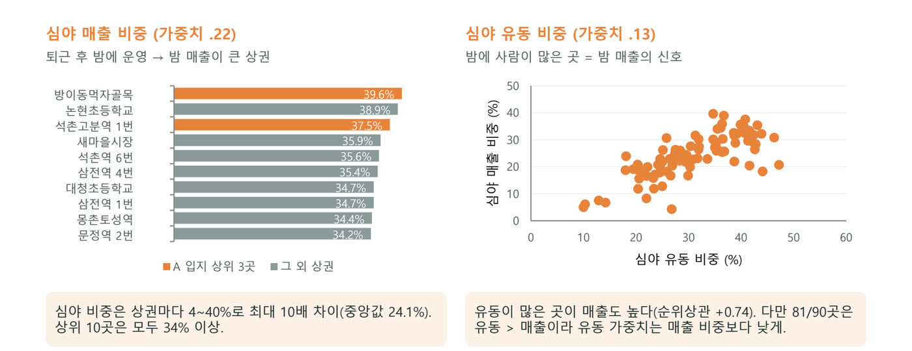

- 심야 매출 비중(가중치 .22) 상위 10곳: 방이동먹자골목 39.6%, 논현초등학교 38.9%, 석촌고분역 1번 37.5%, 새마을시장 35.9%, 석촌역 6번 35.6%, 삼전역 4번 35.4%, 대청초등학교 34.7%, 삼전역 1번 34.7%, 몽촌토성역 34.4%, 문정역 2번 34.2%. 입지 상위 3곳을 주황으로 표시했다.
- 심야 비중은 상권마다 4–40%로 최대 10배 차이(중앙값 24.1%)다. 상위 10곳은 모두 34% 이상이다.
- 심야 유동 비중(가중치 .13): 밤에 사람이 많은 곳은 밤 매출의 신호다(순위상관 +0.74). 다만 81/90곳은 유동이 매출보다 많아 유동 가중치는 매출 비중보다 낮게 둔다.

### 슬라이드 19 · A의 가중치 ② 인건비를 덮고 남는가
*입지 점수 · A*

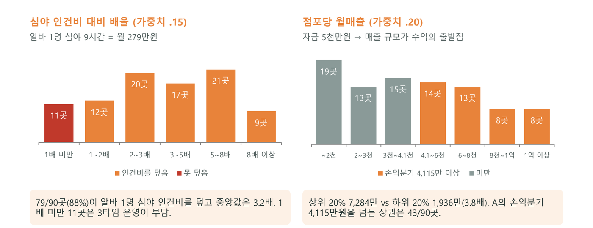

- 심야 인건비 대비 배율(가중치 .15)은 알바 1명 심야 9시간 = 월 279만원 기준이다. 분포: 1배 미만 11곳, 1–2배 12곳, 2–3배 20곳, 3–5배 17곳, 5–8배 21곳, 8배 이상 9곳.
- 79/90곳(88%)이 알바 1명 심야 인건비를 덮고 중앙값은 3.2배다. 1배 미만 11곳은 3타임 운영이 부담이다.
- 점포당 월매출(가중치 .20) 분포: 2천만 미만 19곳, 2–3천 13곳, 3천–4.1천 15곳, 4.1–6천 14곳, 6–8천 13곳, 8천–1억 8곳, 1억 이상 8곳.
- 상위 20% 7,284만원 대 하위 20% 1,936만원(3.8배). A의 손익분기 4,115만원을 넘는 상권은 43/90곳이다(주황).

### 슬라이드 20 · A의 가중치 ③ 낮게 둔 항목: 인구·안정성·경쟁
*입지 점수 · A*

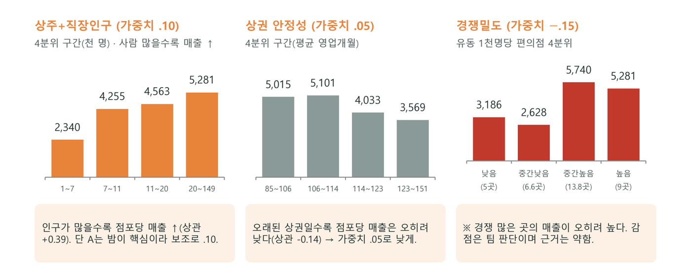

- 상주+직장인구(가중치 .10): 4분위(천 명) 1–7 2,340만, 7–11 4,255만, 11–20 4,563만, 20–149 5,281만원(점포당 월매출 중앙값). 사람이 많을수록 매출이 커지지만(상관 +0.39) A는 밤이 핵심이라 보조로 .10.
- 상권 안정성(가중치 .05): 4분위(평균 영업개월) 85–106 5,015만, 106–114 5,101만, 114–123 4,033만, 123–151 3,569만원. 오래된 상권일수록 점포당 매출은 오히려 낮다(상관 -0.14).
- 경쟁밀도(가중치 -.15): 유동 1천명당 편의점 4분위 낮음(5곳) 3,186만, 중간낮음(6.6곳) 2,628만, 중간높음(13.8곳) 5,740만, 높음(9곳) 5,281만원. 경쟁이 많은 곳의 매출이 오히려 높고 감점은 팀 판단이라 근거가 약하다.

### 슬라이드 22 · B의 조건에서 가중치가 나왔다: 오래 가는 생활권
*입지 점수 · B*

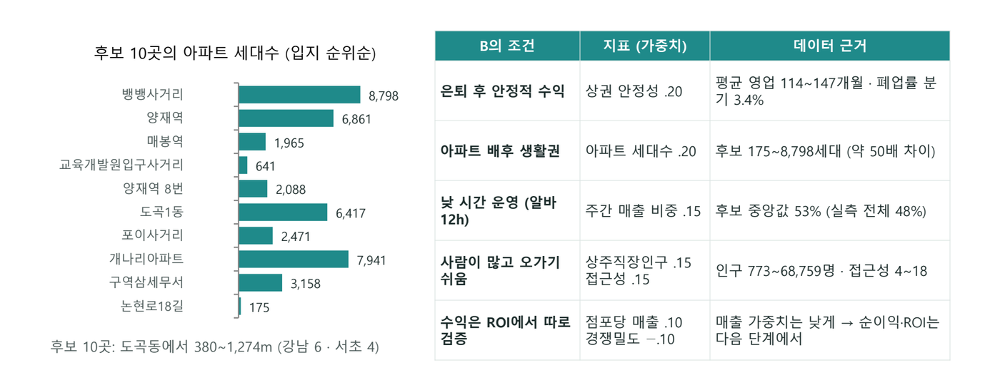

- 후보 10곳은 도곡동에서 380–1,274m(강남 6곳, 서초 4곳)이고 왼쪽 그림은 입지 순위순 아파트 세대수다: 뱅뱅사거리 8,798, 양재역 6,861, 매봉역 1,965, 교육개발원입구사거리 641, 양재역 8번 2,088, 도곡1동 6,417, 포이사거리 2,471, 개나리아파트 7,941, 구역삼세무서 3,158, 논현로18길 175.
- 은퇴 후 안정적 수익 → 상권 안정성 .20: 평균 영업 114–147개월, 분기 폐업률 3.4%.
- 아파트 배후 생활권 → 아파트 세대수 .20: 후보 175–8,798세대(약 50배 차이).
- 낮 시간 운영(알바 12h) → 주간 매출 비중 .15: 후보 중앙값 53%(실측 전체 48%).
- 사람이 많고 오가기 쉬움 → 상주직장인구 .15, 접근성 .15: 인구 773–68,759명, 접근성 4–18.
- 수익은 ROI에서 따로 검증 → 점포당 매출 .10, 경쟁밀도 -.10. 매출 가중치는 낮게 두고 순이익·ROI는 다음 단계에서 본다.

### 슬라이드 23 · B의 가중치 ① 오래 가고 배후가 있는가
*입지 점수 · B*

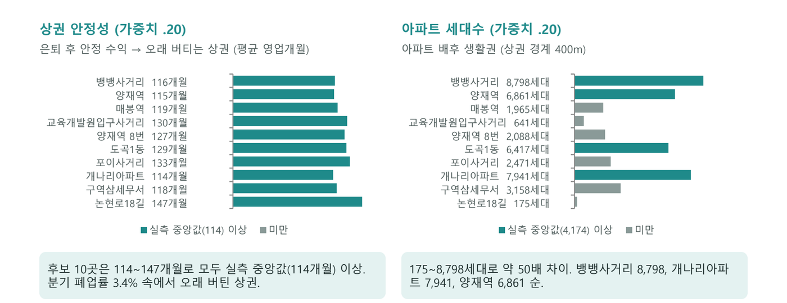

- 상권 안정성(평균 영업개월, 입지 순위순): 뱅뱅사거리 116, 양재역 115, 매봉역 119, 교육개발원입구사거리 130, 양재역 8번 127, 도곡1동 129, 포이사거리 133, 개나리아파트 114, 구역삼세무서 118, 논현로18길 147. 후보 10곳은 모두 실측 중앙값(114개월) 이상이다.
- 아파트 세대수(상권 경계 400m, 서초 추가분 포함): 175–8,798세대로 약 50배 차이다. 뱅뱅사거리 8,798, 개나리아파트 7,941, 양재역 6,861 순이다. 실측 중앙값은 4,174세대다.

### 슬라이드 24 · B의 가중치 ② 낮 장사와 접근성
*입지 점수 · B*

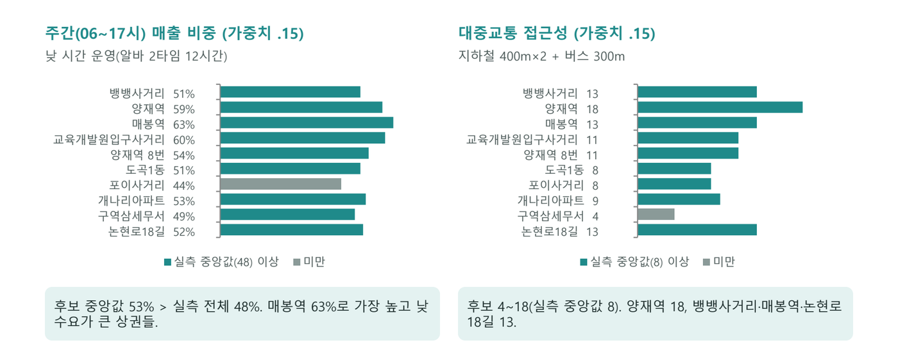

- 주간(06–17시) 매출 비중(알바 2타임 12시간 운영): 뱅뱅사거리 51%, 양재역 59%, 매봉역 63%, 교육개발원입구사거리 60%, 양재역 8번 54%, 도곡1동 51%, 포이사거리 44%, 개나리아파트 53%, 구역삼세무서 49%, 논현로18길 52%. 후보 중앙값 53%가 실측 전체 48%보다 높고 매봉역이 가장 높다.
- 대중교통 접근성(지하철 400m×2 + 버스 300m): 뱅뱅사거리 13, 양재역 18, 매봉역 13, 교육개발원입구사거리 11, 양재역 8번 11, 도곡1동 8, 포이사거리 8, 개나리아파트 9, 구역삼세무서 4, 논현로18길 13. 후보 4–18(실측 중앙값 8)이다.

### 슬라이드 25 · B의 가중치 ③ 인구와 경쟁
*입지 점수 · B*

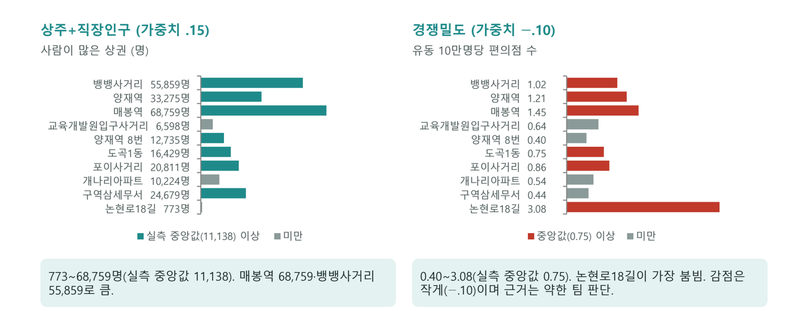

- 상주+직장인구: 뱅뱅사거리 55,859명, 양재역 33,275, 매봉역 68,759, 교육개발원입구사거리 6,598, 양재역 8번 12,735, 도곡1동 16,429, 포이사거리 20,811, 개나리아파트 10,224, 구역삼세무서 24,679, 논현로18길 773. 실측 중앙값은 11,138명이다.
- 경쟁밀도(유동 10만명당 편의점 수): 뱅뱅사거리 1.02, 양재역 1.21, 매봉역 1.45, 교육개발원입구사거리 0.64, 양재역 8번 0.40, 도곡1동 0.75, 포이사거리 0.86, 개나리아파트 0.54, 구역삼세무서 0.44, 논현로18길 3.08. 논현로18길이 가장 붐비고 감점은 작게(-.10) 둔다. 근거는 약한 팀 판단이다.

### 슬라이드 26 · B의 가중치 ④ 점포당 매출을 낮게 둔 결과
*입지 점수 · B*

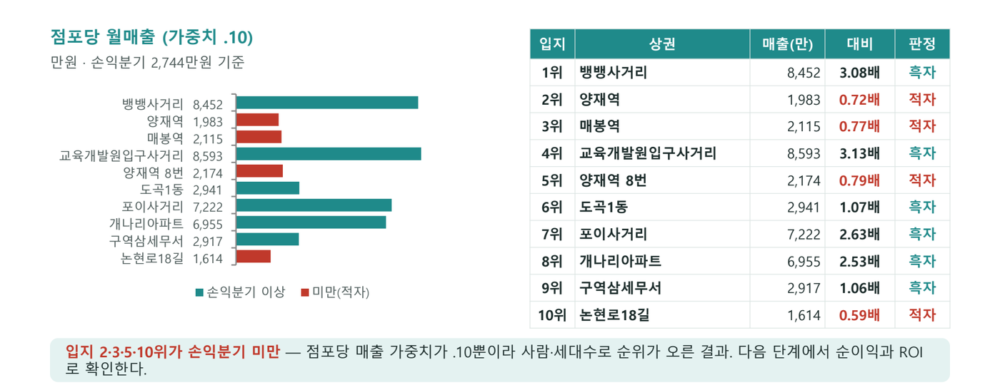

- 점포당 월매출(만원)과 손익분기 2,744만원 대비 판정: 뱅뱅사거리 8,452(3.08배, 흑자), 양재역 1,983(0.72배, 적자), 매봉역 2,115(0.77배, 적자), 교육개발원입구사거리 8,593(3.13배, 흑자), 양재역 8번 2,174(0.79배, 적자), 도곡1동 2,941(1.07배, 흑자), 포이사거리 7,222(2.63배, 흑자), 개나리아파트 6,955(2.53배, 흑자), 구역삼세무서 2,917(1.06배, 흑자), 논현로18길 1,614(0.59배, 적자).
- 입지 2·3·5·10위가 손익분기 미만이다. 점포당 매출 가중치가 .10뿐이라 사람·세대수로 순위가 오른 결과다. 다음 단계에서 순이익과 ROI로 확인한다.
- 손익분기는 GS25 GS2·알바 12시간 기준이다.

### 슬라이드 28 · 입지만 보면 순이익이 마이너스인 곳이 있다
*ROI 고려*

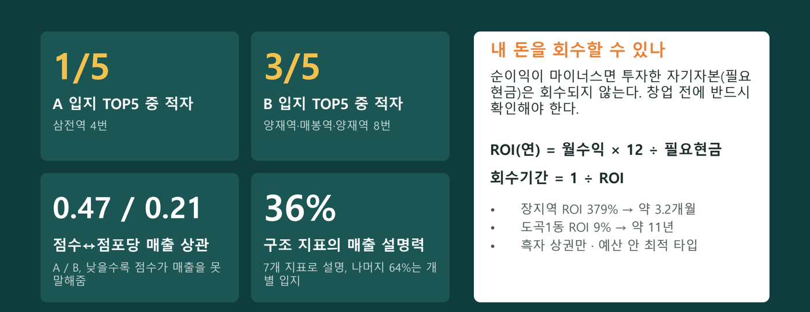

- A 입지 TOP5 중 1곳(삼전역 4번), B 입지 TOP5 중 3곳(양재역·매봉역·양재역 8번)이 적자다.
- 입지 점수와 점포당 매출의 상관은 A 0.47, B 0.21이다. 낮을수록 점수가 매출을 못 말해 준다.
- 7개 구조 지표로는 점포당 매출의 36%만 설명되고 나머지 64%는 개별 입지다.
- 순이익이 마이너스면 투자한 자기자본(필요현금)은 회수되지 않는다. ROI(연) = 월수익 × 12 ÷ 필요현금, 회수기간 = 1 ÷ ROI.
- 장지역 ROI 379% → 약 3.2개월, 도곡1동 ROI 9% → 약 11년. 흑자 상권만, 예산 안 최적 타입으로 계산한다.

### 슬라이드 31 · A: ROI 상위는 손익분기의 약 3배를 파는 상권이다
*ROI 고려*

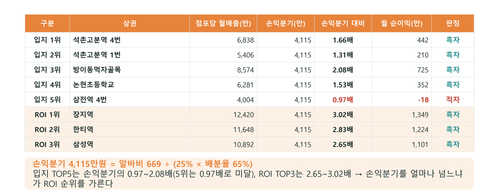

- 손익분기 4,115만원 = 알바비 669 ÷ (25% × 배분율 65%).
- 입지 1–5위: 석촌고분역 4번 6,838만(1.66배, 월 442만, 흑자), 석촌고분역 1번 5,406만(1.31배, 210만), 방이동먹자골목 8,574만(2.08배, 725만), 논현초등학교 6,281만(1.53배, 352만), 삼전역 4번 4,004만(0.97배, -18만, 적자).
- ROI 1–3위: 장지역 12,420만(3.02배, 1,349만), 한티역 11,648만(2.83배, 1,224만), 삼성역 10,892만(2.65배, 1,101만).
- 입지 TOP5는 손익분기의 0.97–2.08배, ROI TOP3는 2.65–3.02배다. 손익분기를 얼마나 넘느냐가 ROI 순위를 가른다.

### 슬라이드 32 · B: 손익분기에 못 미치는 상권이 입지 상위에 섞여 있다
*ROI 고려*

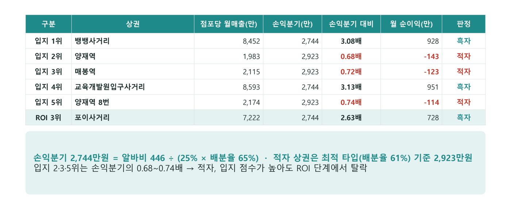

- 손익분기 2,744만원 = 알바비 446 ÷ (25% × 배분율 65%). 적자 상권은 최적 타입(배분율 61%) 기준 2,923만원이다.
- 입지 1위 뱅뱅사거리 8,452만(3.08배, 월 928만, 흑자), 2위 양재역 1,983만(0.68배, -143만, 적자), 3위 매봉역 2,115만(0.72배, -123만, 적자), 4위 교육개발원입구사거리 8,593만(3.13배, 951만, 흑자), 5위 양재역 8번 2,174만(0.74배, -114만, 적자), ROI 3위 포이사거리 7,222만(2.63배, 728만, 흑자).
- 입지 2·3·5위는 손익분기의 0.68–0.74배라 입지 점수가 높아도 ROI 단계에서 탈락한다.

### 슬라이드 33 · ROI를 더하면 순위가 뒤집힌다
*ROI 고려*

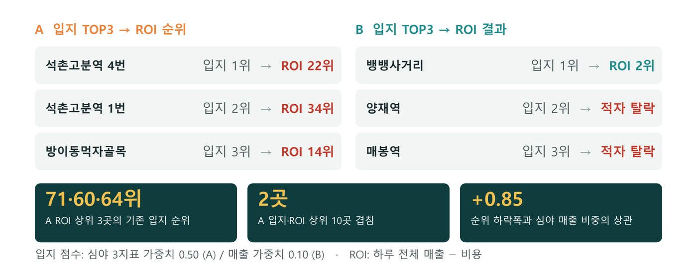

- A 입지 TOP3 → ROI 순위: 석촌고분역 4번 1위 → 22위, 석촌고분역 1번 2위 → 34위, 방이동먹자골목 3위 → 14위.
- B 입지 TOP3 → ROI 결과: 뱅뱅사거리 1위 → 2위, 양재역 2위 → 적자 탈락, 매봉역 3위 → 적자 탈락.
- A ROI 상위 3곳의 기존 입지 순위는 71·60·64위, A의 입지·ROI 상위 10곳은 2곳만 겹친다, 순위 하락폭과 심야 매출 비중의 상관은 +0.85다.
- 입지 점수: 심야 3지표 가중치 0.50(A) / 매출 가중치 0.10(B). ROI: 하루 전체 매출 − 비용.

### 슬라이드 40 · 부록: 경쟁이 많은 곳이 오히려 점포당 매출이 높다
*부록*

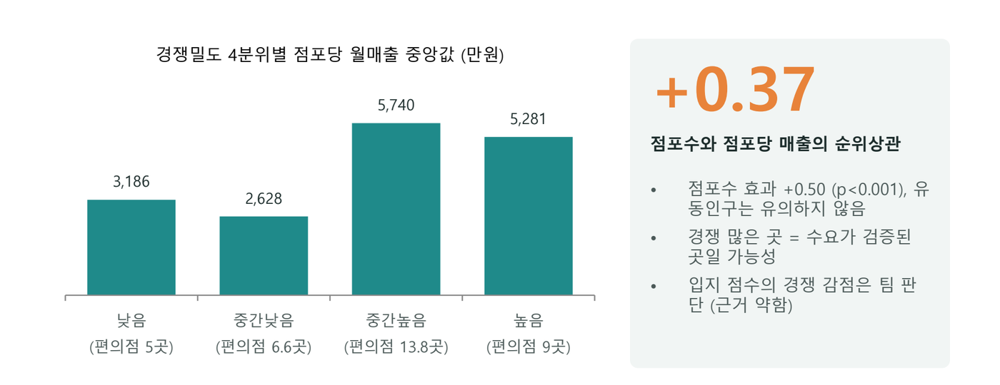

- 경쟁밀도 4분위별 점포당 월매출 중앙값: 낮음(편의점 5곳) 3,186만, 중간낮음(6.6곳) 2,628만, 중간높음(13.8곳) 5,740만, 높음(9곳) 5,281만원.
- 점포수와 점포당 매출의 순위상관은 +0.37이다. 점포수 효과는 +0.50(p<0.001)이고 유동인구는 유의하지 않다.
- 경쟁 많은 곳은 수요가 검증된 곳일 가능성이 있다. 입지 점수의 경쟁 감점은 팀 판단이며 근거가 약하다. 인과가 아니라 동행 관계다.

### 슬라이드 41 · 부록: 입지 점수는 무엇으로 만들어졌나
*부록*

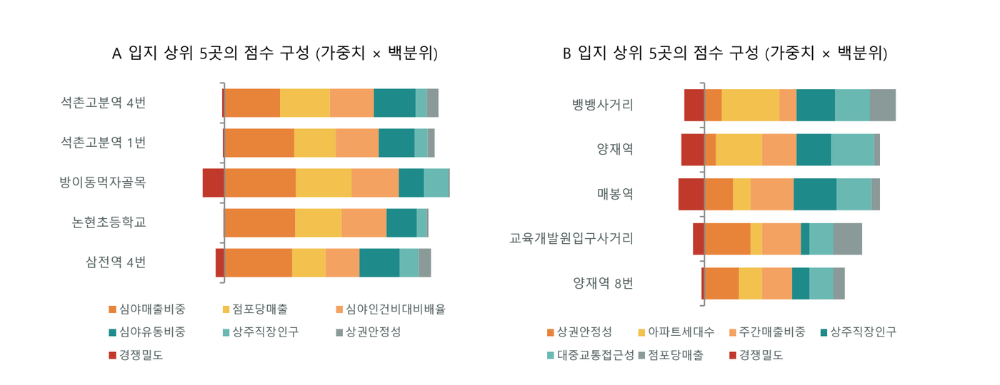

- A 입지 상위 5곳(석촌고분역 4번, 석촌고분역 1번, 방이동먹자골목, 논현초등학교, 삼전역 4번)과 B 입지 상위 5곳(뱅뱅사거리, 양재역, 매봉역, 교육개발원입구사거리, 양재역 8번)의 점수를 지표별 기여(가중치 × 백분위)로 쌓은 막대다. 빨강은 감점(경쟁밀도)이다.
- A는 상위 3곳 점수의 67–72%가 심야 3지표(심야 매출 비중, 심야 인건비 대비 배율, 심야 유동 비중)에서 나온다.

### 슬라이드 44 · 부록: 가맹 타입에 따라 ROI가 달라진다
*부록*

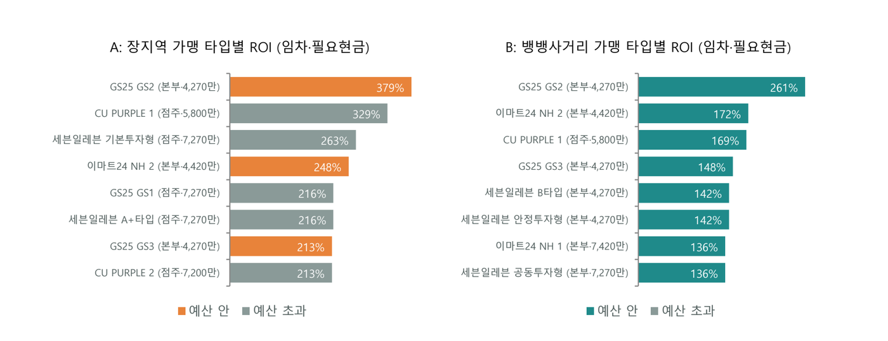

- 왼쪽은 A의 장지역에서 가맹 타입별 ROI다(임차·필요현금): GS25 GS2(본부·4,270만) 379%, CU PURPLE 1(점주·5,800만) 329%, 세븐일레븐 기본투자형(점주·7,270만) 263%, 이마트24 NH 2(본부·4,420만) 248%, GS25 GS1(점주·7,270만) 216%, 세븐일레븐 A+타입(점주·7,270만) 216%, GS25 GS3(본부·4,270만) 213%, CU PURPLE 2(점주·7,200만) 213%. 주황이 A 예산(5,000만원) 안, 회색이 초과다.
- 오른쪽은 B의 뱅뱅사거리다: GS25 GS2 261%, 이마트24 NH 2 172%, CU PURPLE 1 169%, GS25 GS3 148%, 세븐일레븐 B타입 142%, 세븐일레븐 안정투자형 142%, 이마트24 NH 1 136%, 세븐일레븐 공동투자형 136%.
- 출처: 19 가맹조건, 15 임대료, 20 최저임금. 예산 A 5,000만원·B 2.5억원, 상위 8개 타입만 표시했다.

### 슬라이드 45 · 부록: 추천은 손익분기를 넉넉히 넘고 분기별로도 일관된다
*부록*

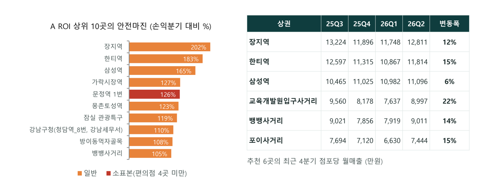

- A ROI 상위 10곳의 안전마진(손익분기 대비 %): 장지역 202%, 한티역 183%, 삼성역 165%, 가락시장역 127%, 문정역 1번 126%(소표본), 몽촌토성역 123%, 잠실 관광특구 119%, 강남구청(청담역 8번·강남세무서) 110%, 방이동먹자골목 108%, 뱅뱅사거리 105%.
- 추천 6곳의 최근 4분기 점포당 월매출(만원): 장지역 13,224/11,896/11,748/12,811(변동폭 12%), 한티역 12,597/11,315/10,867/11,814(15%), 삼성역 10,465/11,025/10,982/11,096(6%), 교육개발원입구사거리 9,560/8,178/7,637/8,997(22%), 뱅뱅사거리 9,021/7,856/7,919/9,011(14%), 포이사거리 7,694/7,120/6,630/7,444(15%).

### 슬라이드 46 · 부록: 입지는 밤을, ROI는 하루 전체를 본다
*부록*

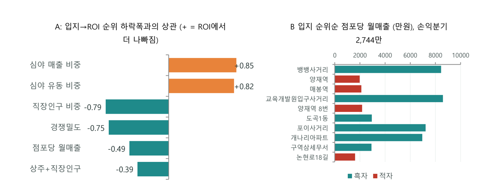

- A: 입지→ROI 순위 하락폭과의 상관(+ = ROI에서 더 나빠짐): 심야 매출 비중 +0.85, 심야 유동 비중 +0.82, 직장인구 비중 -0.79, 경쟁밀도 -0.75, 점포당 월매출 -0.49, 상주+직장인구 -0.39.
- B: 입지 순위순 점포당 월매출과 손익분기 2,744만원(GS25 GS2, 본부 임차 기준)을 비교하면 양재역·매봉역·양재역 8번·논현로18길이 적자다. 점주 임차형 기준 손익분기는 2,923만원이다.

## 15. 출처와 이용 조건

서울특별시 상권분석서비스(서울 열린데이터광장, 공공누리 제1유형), 공공데이터포털(국토교통부 공동주택, 소상공인시장진흥공단 상가(상권)정보), 브이월드 지오코딩, 한국부동산원 R-ONE, 각 브랜드 공식 가맹 안내, 최저임금위원회.

- 임대료(R-ONE)와 공동주택 좌표(브이월드 지오코딩)는 **외부 공개 전 이용약관 확인**이 필요하다. 원천 데이터는 `data_bundle/`에 들어 있으므로 저장소를 공개로 두기 전에 이 두 출처의 이용 조건을 확인한다.
- 추정매출은 카드 기반 보정치(명목)이며 금액이 아니라 상권 간 비교용이다.
- 이 저장소의 점수와 ROI는 가정에 기반한 비교용 시나리오이며 수익을 보장하지 않는다.
